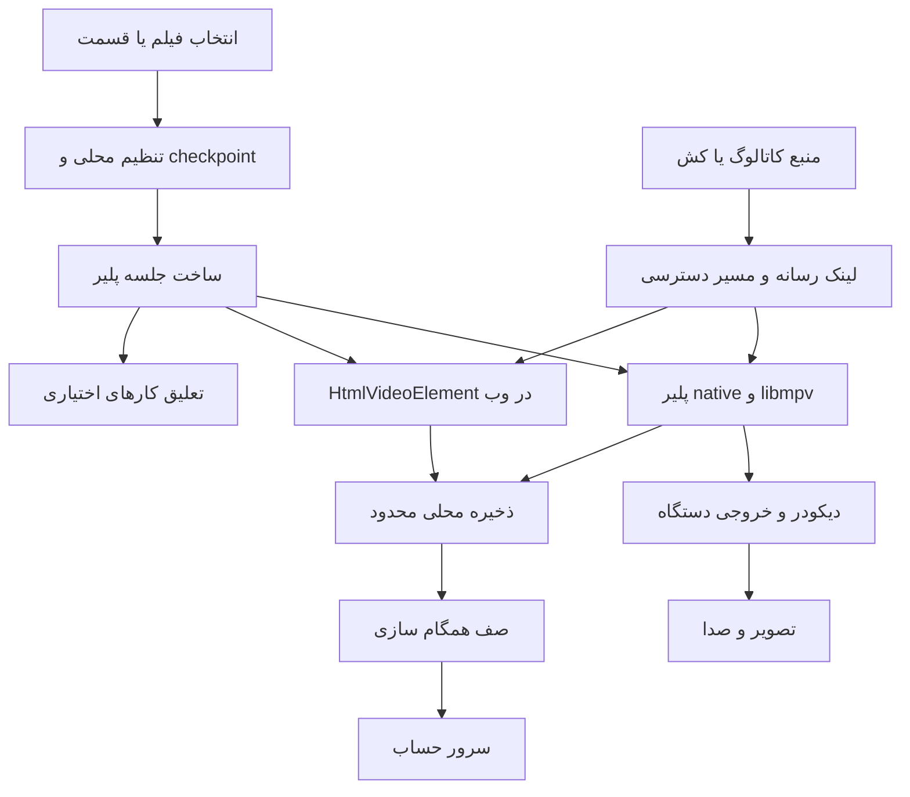
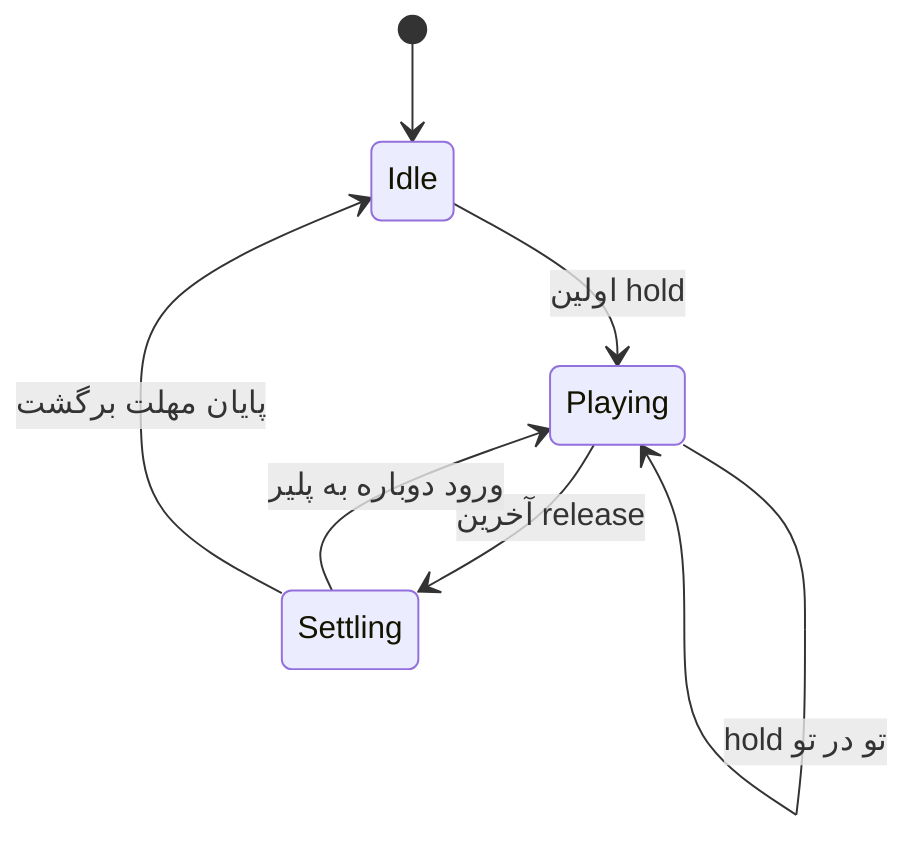
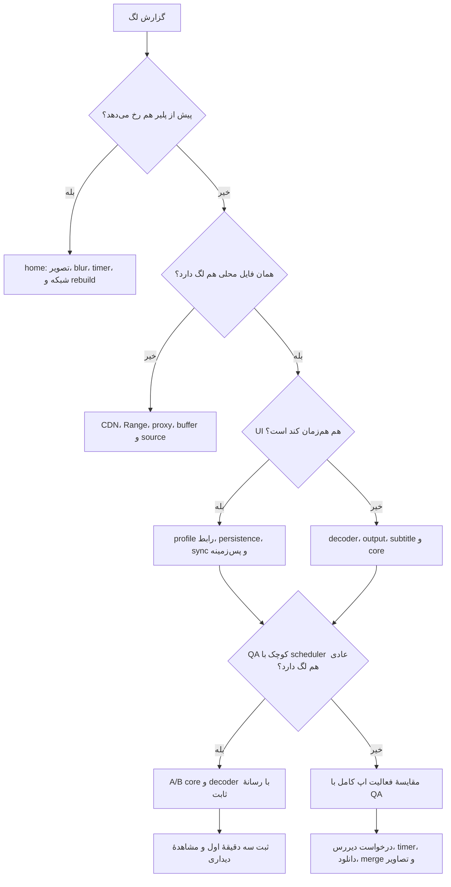

# مرجع جامع عیب‌یابی هنگ، لگ و عملکرد MBNMovie و MBNime

**نسخهٔ سند:** 1 — ۲۰۲۶-۱۰-۲۴

**خط مبنای بررسی‌شده:** MBNMovie `1.0.89+89`، MBNime `2.0.76+76` و سرور در commit `7451b0f`.

**محدوده:** خانه و مرور کاتالوگ، تصاویر و انیمیشن، پلیر داخلی، رمزگشایی و نمایش ویدیو، زیرنویس، ذخیرهٔ محلی، همگام‌سازی، دانلود، قطع ارتباط، Android/Android TV/Windows و وب/PWA آیفون.

این سند برای پیدا کردن دوبارهٔ علت مشکل نوشته شده است. مقادیر، نتایج و نسخه‌ها خط مبنای همین تاریخ هستند؛ در رخداد بعدی ابتدا نسخهٔ واقعاً نصب‌شده را مشخص کنید. عددی که اینجا ثبت شده، تضمین همهٔ دستگاه‌ها، فایل‌ها و نسخه‌های آینده نیست.

مرجع اصلی نگهداری `server/docs/PERFORMANCE_RUNBOOK_FA.md` است. نسخهٔ یکسان این فایل و پیوست‌های `docs/performance/` در هر دو مخزن اپ نگه‌داری می‌شود. هنگام اصلاح، هر سه نسخه را هم‌زمان تغییر دهید. تاریخچهٔ داده و محدودیت‌های اندازه‌گیری را حذف نکنید.

## فهرست قابل مراجعه

1. [راهنمای فوری برای رخداد بعدی](#quick-start)
2. [واژه‌ها و تفکیک نوع لگ](#vocabulary)
3. [خط مبنا و میزان اطمینان شواهد](#baseline)
4. [نقشهٔ مخزن‌ها و فایل‌های مسئول](#source-map)
5. [معماری مسیر پخش و داده](#architecture)
6. [روش ساخت یک بازتولید معتبر](#reproduction)
7. [صفحهٔ اصلی، تصاویر و انیمیشن](#home)
8. [تعلیق کارهای پس‌زمینه و برگشت صحیح](#background)
9. [همگام‌سازی، وضعیت قسمت‌ها و چند دستگاه](#sync)
10. [ذخیرهٔ محلی و قفل‌شدن UI در ویندوز](#persistence)
11. [فهرست قسمت‌ها، کیفیت‌ها و هویت پیشرفت](#episodes)
12. [تنظیم رمزگشایی و قرارداد آن](#decoder-setting)
13. [اندروید قدیمی و مسیر MediaCodec](#android)
14. [Android TV و ورودی کنترل](#tv)
15. [ویندوز و هستهٔ پخش](#windows)
16. [زیرنویس فارسی/انگلیسی و هزینهٔ ASS](#subtitles)
17. [شبکه، بافر، کش و پراکسی](#network)
18. [خاموشی سرور مرکزی و حالت آفلاین](#offline)
19. [وب و PWA آیفون](#web)
20. [شاخص‌ها و نحوهٔ اندازه‌گیری](#measurement)
21. [درخت تصمیم تشخیص علت](#decision-tree)
22. [فرمان‌ها و آزمون‌های تکرارپذیر](#commands)
23. [ماتریس آزمون و معیار پذیرش](#acceptance)
24. [تاریخچهٔ رخدادها و اصلاح‌های واقعی](#incidents)
25. [کارهایی که شواهد کافی نداشتند](#rejected-hypotheses)
26. [ساخت، بستهٔ نصب و انتشار واقعی](#release)
27. [بازگردانی، پاک‌سازی QA و حفظ داده](#rollback)
28. [محدودیت‌های باز و دامنهٔ نتیجه](#limitations)
29. [قواعد نگه‌داری برای جلوگیری از بازگشت مشکل](#maintenance)
30. [فهرست شواهد و الگوی ثبت رخداد](#evidence)

<a id="quick-start"></a>
## ۱. راهنمای فوری برای رخداد بعدی

پیش از تغییر تنظیمات، این هشت مورد را ثبت کنید:

1. اپ و نسخهٔ نصب‌شده، نوع بسته و commit آن؛ صرف دیدن نسخه در `pubspec.yaml` کافی نیست.
2. مدل دستگاه، نسخهٔ سیستم‌عامل، معماری، وضوح/نرخ نوسازی نمایشگر و حالت برق.
3. محل مشکل: خانه، اسکرول، ورود به جزئیات، بازشدن پلیر، خود تصویر، صدا، لمس، فهرست قسمت‌ها یا Back.
4. زمان‌بندی: فقط نخستین اجرای اپ، ابتدای **هر** فیلم، هر ۱۰/۲۰ ثانیه، پس از لمس، هنگام sync یا بعد از چند دقیقه گرم‌شدن دستگاه.
5. فایل ثابت و مشخصات واقعی آن: container، codec، profile، bit depth، رزولوشن، fps و bitrate؛ نام «720p» به‌تنهایی کافی نیست.
6. حالت رمزگشایی انتخابی و دیکودر واقعاً فعال، خروجی ویدیو، حالت زیرنویس و خروجی صدا.
7. وضعیت جداگانهٔ اینترنت، سرور حساب، سرویس کاتالوگ، CDN رسانه و Worker.
8. آزمون‌های مقایسه‌ای انجام‌شده، نتیجهٔ قابل مشاهده و فایل شواهد هرکدام.

سپس به نزدیک‌ترین سطر بروید:

| نشانهٔ اصلی | نخستین مقایسه | محل شروع |
|---|---|---|
| خانه یا اسکرول کند است، پیش از پخش | همان صفحه با تصاویر بارشده و اتصال قطع | [صفحهٔ اصلی](#home) |
| تصویر کند است ولی دکمه‌ها روان‌اند | همان فایل محلی، بدون زیرنویس، سخت‌افزاری/نرم‌افزاری | [اندروید](#android) یا [ویندوز](#windows) |
| تصویر روان است ولی لمس/پنجره‌ها کندند | شمار فریم UI و زمان build/raster هنگام بازکردن قسمت‌ها | [اندازه‌گیری](#measurement) |
| هر ۱۰ یا ۲۰ ثانیه مکث دیده می‌شود | دادهٔ محلی کوچک/بزرگ، sync خاموش/کند | [ذخیره‌سازی](#persistence) و [sync](#sync) |
| ابتدای هر فیلم در ویندوز ۱–۲ دقیقه لگ دارد | پخش با زمان‌بندی عادی در QA جدا + هستهٔ تأییدشده | [رخداد ویندوز](#windows) |
| با قطع سرور همهٔ بخش‌ها خالی می‌شوند | قطع حساب با سالم‌بودن منبع، سپس قطع منبع | [آفلاین](#offline) |
| با زیرنویس مشکل شروع می‌شود | بدون زیرنویس / متنی / ASS اصلی | [زیرنویس](#subtitles) |
| Back کند است یا خانه پس از خروج به‌هم می‌ریزد | باز/بستن پنجرهٔ قسمت‌ها و سپس خروج کامل | [تعلیق و برگشت](#background) |
| فقط نسخهٔ وب مشکل دارد | نسخهٔ دارایی زنده، HtmlVideoElement، PWA و wrapper تولید | [وب](#web) |

برای یک فرضیه، یک متغیر را تغییر دهید. تغییر هم‌زمان codec، کیفیت، هسته، زیرنویس و منبع، حتی اگر تصویر بهتر شود، علت را مشخص نمی‌کند. نتیجه را به ترتیب «نشانه → فرضیه → آزمایش → مشاهده → اصلاح → آزمون بازگشت» ثبت کنید.

<a id="vocabulary"></a>
## ۲. واژه‌ها و تفکیک نوع لگ

### ۲.۱ پنج مشکل متفاوت که کاربر ممکن است همگی را «هنگ» بنامد

| نوع | چیزی که کاربر می‌بیند | شاهد مفید | شاهد ناکافی |
|---|---|---|---|
| کندی دریافت | spinner، توقف به‌علت خالی‌شدن بافر | buffering، وضعیت شبکه و سرعت دریافت | صفر بودن decoder drops |
| کندی decode | صدا جلو می‌رود، دیکودر به نرخ فایل نمی‌رسد | دیکودر فعال، CPU، افت دیکودر، فایل محلی | اینکه فایل بالاخره پخش می‌شود |
| کندی نمایش/presentation | تصویر ریزلگ دارد با وجود decode سالم | مشاهدهٔ A/B، خروجی، cadence، هسته و GPU | فقط شمارندهٔ decoder drops |
| کندی رابط Flutter | لمس دیر پاسخ می‌گیرد، پنجره با تأخیر باز می‌شود | FrameTiming، DevTools و زمان عملیات UI | FPS فایل ویدیو |
| انتظار اشتباه برنامه | صفحه منتظر حساب یا تاریخچه می‌ماند | dependency/timeout و مسیر درخواست | سرعت بالای اینترنت عمومی |

«فایل پخش می‌شود» اثبات پشتیبانی سخت‌افزاری نیست. فایل ممکن است با CPU پخش شود، از مسیر copy-back پرهزینه عبور کند، یا برای نمایش هر فریم مشکل داشته باشد. همچنین «VLC روان است» نشان می‌دهد همان دستگاه و فایل در یک مسیر دیگر توان پخش دارند؛ به‌تنهایی ثابت نمی‌کند مشکل از sync، FFmpeg، Flutter یا یک گزینهٔ خاص است.

### ۲.۲ زمان فریم UI با زمان فریم ویدیو یکی نیست

رابط روی نمایشگر 60Hz حدود 16.67ms برای هر نوسازی فرصت دارد؛ در 120Hz حدود 8.33ms. فیلم 23.976fps فاصلهٔ فریم حدود 41.71ms دارد. مقایسهٔ مستقیم یک timer هشت‌میلی‌ثانیه‌ای، فریم UI و cadence فیلم نتیجهٔ صحیح نمی‌دهد.

سه زمان را جدا ثبت کنید: زمان شروع درخواست، زمان آماده‌شدن/حرکت واقعی ویدیو و زمان قابل مشاهده‌شدن تغییر UI. `Future` بودن یک تابع هم تضمین نمی‌کند محاسبهٔ JSON یا کار سنگین روی isolate رابط انجام نشود.

<a id="baseline"></a>
## ۳. خط مبنا و میزان اطمینان شواهد

### ۳.۱ نسخه‌های مبنا

| جزء | نسخه/commit مبنا | توضیح |
|---|---|---|
| MBNMovie | `1.0.89+89` / `37ba1c47dbabb1b19859e8a07ce25637d4fb4f31` | انتخاب دیکودر + هستهٔ جدید Windows |
| MBNime | `2.0.76+76` / `e2cbfe60461f896238921ead9126a7c5b1f2c04a` | همان قرارداد + حفظ گیت مجوز بخش محدود |
| سرور | `7451b0fd34f945cb311bb385de26782d0edcc8b4` | شناسایی تنظیم دیکودر در منبع تنظیمات |
| Flutter کلاینت/CI | `3.32.8` | مبنای بسته‌های Android API 23؛ ارتقا پروژهٔ جدا می‌خواهد |
| libmpv ویندوز | `mpv v0.41.0-1227-ge471496c5` | build ثابت `20261021-git-e471496c56`، baseline x86_64 |
| مسیر قبلی هستهٔ ویندوز | build `20230924-git-652a1dd` | فقط برای توضیح مقایسهٔ تاریخی |

### ۳.۲ سطوح شاهد را به هم تبدیل نکنید

1. **خواندن کد:** توضیح می‌دهد برنامه چه قراردادی دارد؛ سرعت واقعی را ثابت نمی‌کند.
2. **Unit/widget test:** ادغام، state و یک شاخهٔ منطقی را بررسی می‌کند؛ توان سخت‌افزار را ثابت نمی‌کند.
3. **ساخت موفق:** ABI/بسته‌بندی را تا حدی بررسی می‌کند؛ معادل اجرای رسانه نیست.
4. **اجرای شبیه‌ساز:** مسیر قابل اجرا را بررسی می‌کند؛ MediaCodec واقعی یا مصرف باتری گوشی نیست.
5. **اجرای دستگاه واقعی:** فقط برای همان دستگاه، فایل، تنظیمات و مدت اندازه‌گیری معتبر است.
6. **مقایسهٔ دیداری کاربر:** برای presentation مهم است؛ باید کنار مشخصات و شواهد فنی ثبت شود.
7. **انتشار و آزمون سایت زنده:** جدا از ارسال اکشن و ساخت محلی است.

نتایج ثبت‌شده در این سند از فایل‌های فعلی پروژه و شواهد رخداد به دست آمده‌اند. پیوست [evidence-20261024.json](performance/evidence-20261024.json) خلاصهٔ قابل حمل و SHA256 فایل‌های خام منتخب را دارد. فایل خامِ صرفاً محلی ممکن است در clone تازه موجود نباشد؛ نبود آن را پنهان نکنید.

<a id="source-map"></a>
## ۴. نقشهٔ مخزن‌ها و فایل‌های مسئول

در جدول‌ها، مسیرهای `lib/`، `test/` و `packages/` نسبت به ریشهٔ **هر اپ** هستند. اختلاف فایل‌های مدل و API بین دو اپ را هنگام کپی آزمایش حفظ کنید.

| پوشهٔ workspace | مخزن | نقش |
|---|---|---|
| `delfan_flutter` | [MBNMovie-App](https://github.com/MBNpro-ir/MBNMovie-App) | موویی؛ package برابر `mbnmovie` |
| `animeon_flutter` | [MBNime-App](https://github.com/MBNpro-ir/MBNime-App) | انیمه؛ package برابر `mbnime` |
| `server` | [MBNapp-Server](https://github.com/MBNpro-ir/MBNapp-Server) | حساب، sync، داشبورد، پل وب و ابزار انتشار |

| حوزه | فایل/نماد اصلی | پرسشی که پاسخ می‌دهد |
|---|---|---|
| سیاست دستگاه | `lib/services/device_performance.dart` / `DevicePerformance` | چرا این دستگاه UI سبک دارد؟ |
| خانه و routeها | `lib/screens/main_shell.dart` | آیا صفحات زیر پلیر هنوز کار می‌کنند؟ |
| تصویر و افکت | `lib/widgets/content_art.dart`، `ambient_background.dart`، `pressable.dart` | اندازهٔ decode تصویر و هزینهٔ repaint چقدر است؟ |
| فعالیت پلیر | `lib/services/playback_activity.dart` | چه زمانی کار اختیاری متوقف/ادامه می‌شود؟ |
| دانلود | `lib/services/download_manager.dart` | کدام توقف خودکار است و چه چیزی باید resume شود؟ |
| پلیر | `lib/screens/detail_screen.dart` / `PlayerScreen`، `_PlayerScreenState` | open، seek، pause، خطا، خروج و lifecycle چگونه‌اند؟ |
| تنظیم شروع decode | `lib/widgets/decoder_mode_builder.dart` | انتخاب محلی چه زمانی snapshot می‌شود؟ |
| انتخاب دیکودر | `lib/core/video_decode_mode.dart`، `player_preferences.dart` | کلید و مقدار معتبر چیست؟ |
| سیاست native | `lib/core/native_playback_policy.dart` | vo/hwdec و گزینه‌های هر دستگاه چیست؟ |
| کنترل native Android | `packages/media_kit_video/lib/src/video_controller/android_video_controller/real.dart` | Surface و fallback چگونه عوض می‌شوند؟ |
| رندر Windows | `packages/media_kit_video/windows/video_output.cc` و `angle_surface_manager.cc` | mpv/ANGLE/texture چگونه متصل‌اند؟ |
| هستهٔ Windows | `packages/media_kit_libs_windows_video/windows/CMakeLists.txt` | دقیقاً کدام DLL دانلود و کنترل می‌شود؟ |
| ذخیرهٔ Windows | `packages/shared_preferences_windows/lib/shared_preferences_windows.dart` | encode و نوشتن فایل روی چه مسیری‌اند؟ |
| نوشتن گروهی | `lib/services/preference_batch_io.dart` | چند تغییر، چند فایل‌نویسی ایجاد می‌کند؟ |
| پیشرفت پخش | `lib/core/watch_progress.dart` و `watch_clock.dart` | زمان/هویت checkpoint و صف ذخیره چیست؟ |
| همگام‌سازی | `lib/services/mbn_sync.dart`، `lib/core/sync_merge.dart` | پاسخ دیررس، dirty state و merge چگونه کنترل می‌شوند؟ |
| فهرست قسمت | `lib/core/episode_catalog.dart`، `lib/widgets/player_season_selector.dart` | کیفیت‌ها چگونه به یک قسمت منطقی وصل می‌شوند؟ |
| کاتالوگ موویی | `lib/services/movie_api.dart`، `lib/services/network_gate.dart` | مسیر پل/مهمان/کش چگونه انتخاب می‌شود؟ |
| کاتالوگ انیمه | `lib/services/animeon_api.dart` | کار کاتالوگ کجا پشت `whenIdle()` قرار دارد؟ |
| مجوز بخش محدود انیمه | `lib/services/adult_access.dart`، `lib/widgets/adult_access_gate.dart` | چه بررسی امنیتی باید فعال بماند؟ |
| زیرنویس | `lib/core/subtitle_bidi.dart`، `subtitle_order.dart`، `ass_subtitles.dart`، `web_subtitles.dart` | ترتیب منبع، نمایش متن و ASS چه تفاوتی دارند؟ |
| نمایش زیرنویس | `lib/widgets/player_subtitle_text.dart`، `lib/core/subtitle_layout.dart` | geometry متن و هزینهٔ نمایش کجاست؟ |
| وب | `lib/services/browser_features_web.dart`، `lib/widgets/browser_video_view_web.dart` | HtmlVideoElement و viewport چگونه مدیریت می‌شوند؟ |
| مقیاس/ورودی وب | `lib/app.dart` / `AccessibilityAppWrapper`، `web/index.html` | لمس واقعی و مختصات با Flutter هم‌خوان‌اند؟ |
| سلامت سرور | `lib/widgets/server_status_gate.dart` | UI قطع حساب چرا نمایش داده می‌شود؟ |
| backend | `server/backend/db.py`، `app.py` و `tests/` | merge و تنظیمات قابل استفاده چگونه ذخیره می‌شوند؟ |
| انتشار | `.github/workflows/release.yml`، `player-qa.yml`، `publish-web.yml` | چه بررسی‌هایی انتشار را متوقف می‌کنند؟ |

برای پیدا کردن نماد فعلی از `rg` استفاده کنید؛ شمارهٔ خط با تغییر فایل جابه‌جا می‌شود:

```powershell
rg -n 'holdPlayback|_deferForPlayback|syncAll' lib/services/mbn_sync.dart
rg -n 'PlaybackActivity|TickerMode|_restartAutoPlay' lib/screens/main_shell.dart
rg -n '_openRoutedMedia|_persistProgress|_remotePreferencesChanged' lib/screens/detail_screen.dart
rg -n 'hwdec|_directConfigured|recoverVideoOutput' packages/media_kit_video/lib
```

<a id="architecture"></a>
## ۵. معماری مسیر پخش و داده



سرور حساب با میزبان ویدیو یکی نیست. ممکن است حساب قطع باشد و CDN سالم بماند؛ ممکن است login سالم باشد ولی CDN کند باشد. برعکس، فایل محلی به CDN نیاز ندارد ولی بار decode/render همچنان وجود دارد.

مسیر UI نباید برای نمایش وضع قسمت‌ها منتظر دریافت کامل history از سرور بماند. checkpoint محلی باید مستقل حفظ شود. کارهای حجیم حساب در حضور پلیر defer می‌شوند، اما برخی checkpointهای معنی‌دار و بررسی اعتبار حساب/مجوز باقی می‌مانند. عبارت «همه‌چیز پس‌زمینه خاموش است» توصیف دقیق این قرارداد نیست.

<a id="reproduction"></a>
## ۶. روش ساخت یک بازتولید معتبر

### ۶.۱ بستهٔ اولیهٔ بازتولید

یک فایل مصنوعی یا فایل مجاز با SHA256 مشخص انتخاب کنید. برای مسئلهٔ «ابتدای هر فیلم»، کلیپ شش‌ثانیه‌ای کافی نیست؛ حداقل سه دقیقهٔ پیوسته و چند بار بازکردن مستقل لازم است. آزمایش کوتاه API 23 برای smoke test مفید است، اما مسئلهٔ دو دقیقهٔ اول را اندازه نمی‌گیرد.

سه حالت را جدا اجرا کنید:

- **Cold app:** برنامه از فرایند تازه و با همان دادهٔ کاربرِ QA شروع می‌شود.
- **New media:** خود برنامه باز است، ولی فیلم/قسمت جدید وارد پلیر می‌شود.
- **Steady playback:** چند دقیقه از آغاز گذشته و کنترل‌ها مخفی‌اند.

دستگاه، منبع، کیفیت، نرخ نمایشگر و حالت زیرنویس را در مقایسهٔ A/B ثابت نگه دارید. ترتیب A/B را در تکرار دوم جابه‌جا کنید تا گرم‌شدن cache به‌جای بهبود کد تفسیر نشود. یک baseline محلی و یک baseline شبکه‌ای داشته باشید.

### ۶.۲ ترتیب آزمایش‌های کم‌هزینه

1. همان فایل را در برنامه و پلیر مرجع اجرا کنید و codec/fps واقعی را تأیید کنید.
2. بدون زیرنویس و بدون تغییر کیفیت دوباره اجرا کنید.
3. فایل محلی همان رسانه یا fixture هم‌مشخصات را اجرا کنید.
4. سخت‌افزاری و نرم‌افزاری را از تنظیمات انتخاب و **پلیر را دوباره باز** کنید.
5. سرور sync را با mock/تزریق خطا کند یا ناموجود کنید؛ CDN را سالم نگه دارید.
6. در بستهٔ QA جدا، همان `PlayerScreen` را با scheduler عادی اجرا کنید.
7. سپس هسته، مسیر خروجی، presentation و هزینهٔ UI را بررسی کنید.

آزمایش‌های integration که با `tester.pump()` کار می‌کنند برای عملکرد state و input لازم‌اند. برای حکم دربارهٔ ریزلگ دیداری Windows، یک اجرای جدا با `WidgetsFlutterBinding` عادی هم لازم است. `fullyLive` به‌تنهایی همهٔ تفاوت‌های harness را حذف نمی‌کند.

### ۶.۳ حفظ داده و مقایسهٔ منصفانه

Preferences و فایل‌های QA را در پوشهٔ موقت جدا قرار دهید. اجرای QA نباید حساب، history، دانلودها یا mutex برنامهٔ نصب‌شده را تصاحب کند. در Android از package آزمایشی جدا و در Windows از title/mutex مجزا استفاده کنید. تغییر موقت runner را وارد release نکنید.

در گزارش ثبت کنید که خاموشی از طریق خطای تزریق‌شده، route مرورگر یا قطع فیزیکی شبکه ایجاد شده است. این سه روش معادل یکدیگر نیستند. برای آزمون خطای سرور، خاموش‌کردن production یا دست‌کاری فایروال سراسری لازم نیست.

<a id="home"></a>
## ۷. صفحهٔ اصلی، تصاویر و انیمیشن

### ۷.۱ قرارداد UI سبک

`DevicePerformance` بر اساس وضعیت **همین دستگاه** تصمیم می‌گیرد. برخلاف انتخاب دیکودر، این پروفایل با حساب به دستگاه دیگر کپی نمی‌شود. در مبنای فعلی، Android SDK معلوم تا 32، دستگاه low-RAM، TV و Apple-mobile web مسیر سبک را فعال می‌کنند.

| سیاست | Apple-mobile web | native سبک | عادی |
|---|---:|---:|---:|
| عرض هدف artwork عمودی | 240 | 320 | 512 |
| عرض هدف artwork افقی | 640 | 960 | 1280 |
| مدت route | 120ms | 180ms | 380ms |
| سقف cache تصویرِ تنظیم‌شده | 24MiB / 80 تصویر | 48MiB / 140 تصویر | این کلاس سقف ویژه‌ای تعیین نمی‌کند |

این اعداد اندازهٔ هدف decode تصویرند، نه تضمین اندازهٔ دانلود HTTP. برای ارزیابی مصرف شبکه، request واقعی میزبان تصویر را جدا اندازه بگیرید. cache تصویر نیز فقط یکی از مصرف‌کنندگان حافظه است؛ texture ویدیویی، codec و Dart heap خارج از این عددند.

### ۷.۲ ترتیب بررسی هنگ خانه

1. مقدار تشخیص SDK/lowRam/TV/Apple-mobile را در QA ثبت کنید. مقدار ناشناخته را با «دستگاه قوی» یکی نگیرید.
2. خانه را با تصاویر cacheشده و دوباره با cache سرد آزمایش کنید؛ این دو عدد را جدا بنویسید.
3. بررسی کنید `content_art.dart` همچنان اندازهٔ هدف را به image provider منتقل می‌کند و با هر rebuild همهٔ candidateها دوباره probe نمی‌شوند.
4. در `AmbientBackground`، مسیر سبک باید به پس‌زمینهٔ ساده برسد. به وجود `RepaintBoundary` اکتفا نکنید؛ shader، blur و repaint واقعی را ببینید.
5. autoplay بنرها و timerها را بررسی کنید. `TickerMode` به‌تنهایی timer معمولی را متوقف نمی‌کند.
6. رفتن خانه → جزئیات → Back و خانه → پلیر → Back را جدا مقایسه کنید. حفظ state نباید با شروع موازی درخواست‌های تکراری همراه شود.
7. فهرست بلند، تصاویر بزرگ و دادهٔ history زیاد را به‌صورت مستقل وارد آزمون کنید.

هدف، حذف بی‌قید همهٔ انیمیشن‌ها نیست. حرکت کوتاه لمس و جابه‌جایی صفحه می‌تواند باقی بماند؛ افکت دائمی و تصویر بیش‌ازنیاز نباید بودجهٔ دستگاه ضعیف را مصرف کند.

### ۷.۳ خطاهای رایج در اصلاح خانه

`Offstage`، پوشاندن صفحه با route جدید یا قرار دادن widget زیر پلیر، تضمین توقف کار آن نیست. خاموش‌کردن یک AnimationController هم درخواست شبکهٔ در حال اجرا را لغو نمی‌کند. هر timer، subscription، image probe و ادامهٔ Future باید صاحب و شرط ادامهٔ روشن داشته باشد.

در عیب‌یابی تصویرِ مفقود یا placeholder طولانی، خطای MIME/مسیر/CORS را از هزینهٔ decode جدا کنید. پاسخ HTTP 200 با بدنهٔ خطا به‌جای تصویر، بهینه‌سازی cache نمی‌خواهد؛ نیاز به تشخیص پاسخ دارد.

<a id="background"></a>
## ۸. تعلیق کارهای پس‌زمینه و برگشت صحیح

### ۸.۱ دو نگه‌دارندهٔ مجزا

ورود به پلیر دو lease می‌گیرد:

- `PlaybackActivity.hold()` برای کارهای اختیاری اپ و UI زیر route؛
- `MbnSync.instance.holdPlayback()` برای defer کارهای حجیم حساب و reconcile پاسخ‌ها.

در مبنای فعلی، پس از آخرین release، فعالیت UI حدود **550ms** و sync حدود **600ms** برای پایان transition برگشت صبر می‌کند. این عددها دلیل برای افزودن sleep بیشتر نیستند؛ اگر Back کند شد ابتدا stack، کارهای resume و تعداد leaseها را بررسی کنید.



release باید idempotent باشد: دوبار صدا زدن همان closure نباید شمارنده را منفی کند. یک پلیر/مسیر تودرتو نباید با release مسیر دیگر فعالیت را زود از سر بگیرد.

### ۸.۲ چه چیزهایی متوقف می‌شوند؟

| کار | رفتار مورد انتظار |
|---|---|
| ticker/انیمیشن صفحات زیر پلیر | غیرفعال با حفظ state صفحه |
| autoplay بنر | timer/شرط فعالیت هم متوقف می‌شود |
| واکشی اختیاری کاتالوگ و پروفایل | پشت `PlaybackActivity.whenIdle()` قرار می‌گیرد |
| bulk sync حساب | defer و coalesce؛ پاسخ قدیمی وسط پخش اعمال نمی‌شود |
| دانلود فعال یا در صف قابل توقف | موقتاً pause و شناسهٔ توقف خودکار ثبت می‌شود |
| پیشرفت پخش | محدود و محلی باقی می‌ماند |
| اعتبار حساب و مجوز بخش محدود | قرارداد امنیتی فعال می‌ماند |
| خود دریافت جریان ویدیو/صدا | برای پخش لازم است و متوقف نمی‌شود |

این مکانیزم کار شروع‌شده را به‌طور جادویی قطع نمی‌کند. ادامهٔ عملیات باید پس از await نیز generation/فعال‌بودن را بررسی کند. `whenIdle()` را جلوی خود رسانه‌ای که برای شروع پلیر لازم است قرار ندهید؛ در این صورت پلیر منتظر پایان فعالیت خودش می‌ماند.

### ۸.۳ تست Back که حتماً باید تکرار شود

1. در خانه اسکرول کنید و یک عنوان را باز کنید.
2. پلیر را باز کنید؛ activity باید فعال شود.
3. فهرست قسمت‌ها را باز و در ۳۰۰ قسمت اسکرول کنید.
4. Back نخست فقط پنجره را ببندد و ویدیو ادامه یابد.
5. Back بعدی پلیر را ببندد و پیشرفت آخر ذخیره شود.
6. صفحهٔ قبل با state درست نمایش داده شود؛ پس از transition کارهای اختیاری ادامه یابند.
7. دانلودی که خودکار pause شده resume شود؛ توقف دستی کاربر یا `allPaused` حفظ شود.
8. ده بار ورود/خروج را تکرار کنید و افزایش timer/subscription، resume چندباره یا activity گیرکرده را بررسی کنید.

در انیمه، revoke مجوز می‌تواند route را از بیرون unmount کند؛ cleanup باید در همین حالت هم leaseها و منابع پلیر را آزاد کند. مسیر خطا، خطای open و خروج پیش از آماده‌شدن preference نیز باید قابل برگشت باشد.

<a id="sync"></a>
## ۹. همگام‌سازی، وضعیت قسمت‌ها و چند دستگاه

### ۹.۱ قرارداد حیاتی

کلیک روی قسمت، نمایش وضعیت دیده‌شده و کنترل پلیر نباید به اتمام یک sync کامل وابسته شود. دادهٔ محلی در دسترس است؛ وضعیت سرور بعداً merge می‌شود. برای رخداد «سرور کند است و پنجرهٔ قسمت‌ها هنگ می‌کند»، زنجیرهٔ await را از onTap تا ساخت پنجره دنبال کنید.

`syncAll()` در حضور playback hold defer می‌شود. پس از برگشت پاسخ شبکه هم دوباره وضعیت playback، generation و credential بررسی می‌شود. درخواست شروع‌شده پیش از پلیر نباید هنگام پخش هزاران رکورد را ناگهان اعمال کند.

### ۹.۲ cadence مبنا

| عملیات | سیاست مبنا |
|---|---|
| checkpoint عادی پلیر | timer محلی 10s؛ مقدار بدون تغییر دوباره نوشته نمی‌شود |
| ارسال عادی progress | فاصلهٔ مبنا 20s؛ آخرین وضعیت هم‌جوش می‌شود |
| pause/خروج/مرز قسمت | checkpoint معنی‌دار با `pushProgressNow()`؛ با tick معمولی یکی نیست |
| دریافت برای ادامهٔ تماشا | `syncProgressIfStale()` با فاصلهٔ حداقل 15s |
| تغییرات پیوستهٔ تنظیمات | مسیر throttled با timer حدود 800ms؛ بعضی مسیرها cadence جدا دارند |
| بازگشت از پلیر | resume حجیم پس از مهلت 600ms و رفع آخرین hold |

این جدول هدف تنظیم هر timer در همهٔ فایل‌ها نیست. برای timer مورد نظر source را بخوانید؛ حذف throttle برای «sync لحظه‌ای» می‌تواند بار شبکه، serialization و rebuild را به هر tick منتقل کند.

### ۹.۳ خطاهایی که باید از آن‌ها جلوگیری شود

- پاسخ دیررس، تغییر آفلاین جدیدتر را پاک کند.
- آپلود قدیمیِ بدون تغییر، favorite حذف‌شده یا وضعیت قبلی قسمت را برگرداند.
- rewind عمدی کاربر با قاعدهٔ «همیشه بزرگ‌ترین position» نادیده گرفته شود.
- تغییر حساب در وسط Future، دادهٔ حساب اول را در حساب دوم اعمال کند.
- هنگام پخش، پاسخ حجیم PUT checkpoint فوراً در تمام state محلی reconcile شود.
- برای هر بازشدن پنجرهٔ قسمت‌ها، یک درخواست کامل مجزا ایجاد شود.

base snapshot، revision/dirty state، generation و identity حساب را با هم بررسی کنید. افزایش timeout این خطاهای منطقی را اصلاح نمی‌کند.

### ۹.۴ آزمایش فشار ثبت‌شده

در هر دو اپ، تست native ویندوز با فایل مصنوعی **2560×1440 / 30fps**، **۴۰۰۰** کلید تاریخچه، **۱۰۰۰۰** کلید پاسخ تأخیری و **۳۰۰** قسمت انجام شد. پنجرهٔ قسمت‌ها در موویی **68ms** و در انیمه **66ms** باز شد؛ افت دیکودر اضافه و افزایش افت خروجی در فاز اندازه‌گیری ثبت نشد.

این تست در آن مرحله از `d3d11va-copy` استفاده می‌کرد. موفقیتش نشان‌دهندهٔ جداشدن فشار sync از پلیر است؛ همان زمان، کاربر همچنان ریزلگ ابتدایی ویندوز را می‌دید. آن را شاهد حل کامل presentation ندانید.

<a id="persistence"></a>
## ۱۰. ذخیرهٔ محلی و قفل‌شدن UI در ویندوز

### ۱۰.۱ علت واقعی ثبت‌شده

در بررسی ۱۱ اکتبر، پیاده‌سازی Windows SharedPreferences برای هر mutation کل map را به JSON تبدیل و فایل را روی مسیر رابط به‌صورت همگام می‌نوشت. history بزرگ و چند ذخیرهٔ پشت‌سرهم می‌توانستند وقفهٔ دوره‌ای بسازند.

اصلاح محلی در `packages/shared_preferences_windows`، encode را با worker isolate و I/O را ناهمگام انجام می‌دهد و snapshotهای نوشتن را مرتب می‌کند. `writePreferenceBatch()` برای چند فیلد مرتبط روی Windows از `updateValues()` استفاده می‌کند؛ ارسال چند setter جدا برای یک checkpoint می‌تواند این مزیت را از بین ببرد.

### ۱۰.۲ دادهٔ تاریخی و تفسیر آن

| اندازهٔ داده | بیشترین gap پیش از اصلاح | پس از اصلاح موویی | پس از اصلاح انیمه |
|---|---:|---:|---:|
| 32KiB | 12.0ms | 11.1ms | 16.0ms |
| 2MiB | 47.7ms | 16.6ms | 17.0ms |

این اعداد برای تست debug مصنوعی همان workstation و همان نسخه‌اند. فاصلهٔ callback timer، مدت توقف واقعی تصویر نیست. در تست تکمیلی، baseline بدون فشار نیز اندازه‌گیری شد تا زمان‌بندی عادی Windows با مکث persistence اشتباه نشود. جزئیات تاریخی در `docs/player-performance-2026-10-11.md` هر اپ موجود است.

### ۱۰.۳ در بازگشت مشکل چه چیزی را اندازه بگیریم؟

1. اندازهٔ فایل preferences و تعداد کلیدها؛ محتویات کامل فایل لازم نیست.
2. تعداد فایل‌نویسی واقعی برای یک ذخیرهٔ progress یا تغییر subtitle.
3. زمان encode، زمان I/O و فاصلهٔ callback رابط به‌صورت جدا.
4. ترتیب snapshotها در mutationهای هم‌زمان، remove/clear و شکست I/O.
5. تعداد درخواست‌های صف‌شده در ۶۰ ثانیه pause یا پخش ثابت.

`WatchProgressStore` صف نامحدود FIFO از checkpointهای قدیمی نمی‌سازد؛ آخرین snapshot را نگه می‌دارد. هنگام تغییر این بخش، حفظ آخرین state مهم‌تر از نوشتن تک‌تک موقعیت‌های منسوخ است. بااین‌حال، mark watched، reset دستی و checkpoint نهایی نباید در یک بهینه‌سازی ساده گم شوند.

موازی‌کردن بی‌قید نوشتن‌ها، دست‌کاری prefix کلیدهای legacy یا عوض‌کردن storage رمزنگاری‌شده برای سرعت، راه‌حل این رخداد نیست. کلیدهای Windows legacy با `flutter.` ذخیره می‌شوند؛ API منطقی اپ عموماً بدون آن prefix است.

<a id="episodes"></a>
## ۱۱. فهرست قسمت‌ها، کیفیت‌ها و هویت پیشرفت

یک قسمت منطقی می‌تواند چند variant کیفیت/سرور داشته باشد. `EpisodeCatalog` گروه‌بندی را برای session آماده می‌کند. بازسازی گروه‌ها روی هر رویداد position یا هر rebuild پنجره، هزینه‌ای غیرضروری است.

هویت progress باید از قسمت منطقی یا `progressEpisodeId` معتبر بیاید. استفادهٔ خام از شناسهٔ فایلِ کیفیت دیگر می‌تواند باعث شود قسمت دیده‌شده دوباره نادیده نمایش داده شود یا فایل دانلودی history جدا بسازد. این مشکل گاهی با spinner و «دریافت وضعیت» اشتباه گرفته می‌شود.

سناریوهای ضروری:

- ۳۰۰ قسمت با ترکیب دیده‌شده/ندیده/نیمه‌تمام؛
- تعویض 480p ↔ 720p ↔ 1080p با هویت مشترک؛
- بازکردن پنجره هنگام سرور قطع یا پاسخ دیررس؛
- بازشدن دوبارهٔ پنجره بدون دانلود history از ابتدا؛
- انتخاب سریع قسمت جدید در حال ذخیرهٔ قسمت قبل؛
- Back از پنجره بدون خروج از ویدیو؛
- فایل دانلودی با metadata گروه منطقی و resume صحیح.

در player transition، timer عادی progress نباید duration/position قسمت جدید را به قسمت قبلی نسبت دهد. علاوه بر زمان بازشدن پنجره، صحت رکورد ذخیره‌شده را هم بررسی کنید.

<a id="decoder-setting"></a>
## ۱۲. تنظیم رمزگشایی و قرارداد آن

### ۱۲.۱ انتخاب کاربر با مسیر واقعاً فعال تفاوت دارد

کلید محلی `player_decoder_mode` فقط دو مقدار معتبر `hardware` و `software` دارد. مقدار مفقود یا نامعتبر به hardware برمی‌گردد. گزینهٔ سخت‌افزاری ترجیح استفاده از مسیر مناسب دستگاه است؛ باید `hwdec-current` را هم ببینید تا بفهمید واقعاً چه دیکودری فعال شده است. software روی native به `hwdec=no` تبدیل می‌شود؛ GPU همچنان برای نمایش تصویر استفاده می‌شود.

فایل‌های مسئول در هر دو اپ: `lib/core/video_decode_mode.dart`، `lib/core/player_preferences.dart`، `lib/widgets/decoder_mode_builder.dart` و `lib/core/native_playback_policy.dart`. UI در `settings_screen.dart` و همگام‌سازی در `mbn_sync.dart` است. سمت سرور، اعتبارسنجی preferences در `backend/db.py` نیز جزئی از قرارداد است.

### ۱۲.۲ زمان اعمال و همگام‌سازی

1. ورود به پلیر، snapshot تنظیم را **از حافظهٔ محلی** می‌گیرد.
2. پس از آماده‌شدن snapshot، VideoController با همان مقدار ساخته می‌شود.
3. پلیر فعلی با پاسخ دیررس sync ناگهان دیکودر عوض نمی‌کند.
4. انتخاب جدید در ورود بعدی به پلیر اعمال می‌شود؛ برای مقایسه، واقعاً پلیر را ببندید و دوباره باز کنید.
5. حساب، مقدار را در bucketهای موجود `windows/android/web/tv/other` نگه می‌دارد. تغییر Windows نباید Android را بازنویسی کند.
6. در وب انتخاب ذخیره و sync می‌شود، ولی مرورگر دیکودر واقعی را تعیین می‌کند. این گزینه API اجباری برای تغییر decoder مرورگر نیست.

این انتخاب با «پروفایل سبک دستگاه» متفاوت است. مدل دستگاه، RAM و سیاست سبک رابط به حساب دیگر یا دستگاه قوی‌تر منتقل نمی‌شوند.

### ۱۲.۳ آزمون بازگشت

برای هر دو اپ مقدار خالی، نامعتبر، سخت‌افزاری و نرم‌افزاری را آزمایش کنید؛ سپس آفلاین انتخاب کنید، صفحه را دوباره باز کنید و وارد پلیر شوید. در دو نشست مستقل، Windows=software و Android=hardware ثبت کنید و هر دو را دوباره بخوانید. Back پیش از پایان خواندن preference نباید controller سرگردان یا activity hold باقی بگذارد. تغییر UI بدون بررسی property واقعی native، آزمون کامل decoder نیست.

در baseline، round-trip واقعی HTTPS دو نشست با موفقیت ثبت شد و حساب موقت حذف شد. شواهد در manifest پیوست با شناسهٔ `live-decoder-sync` آمده است.

<a id="android"></a>
## ۱۳. اندروید قدیمی و مسیر MediaCodec

### ۱۳.۱ چرا پخش‌شدن فایل کافی نیست؟

در گوشی قدیمی، کپی هر فریم decodeشده به RAM و سپس texture می‌تواند از خود decode سنگین‌تر شود. 480p بهتر از 720p بودن با این فرضیه سازگار است، اما اثبات آن نیست. codec، profile، bit depth، fps و مسیر خروجی را باید ثبت کرد؛ برچسب «720p» فقط دو بعد از مسئله را خلاصه می‌کند.

### ۱۳.۲ سیاست فعلی native

| محیط | انتخاب سخت‌افزاری | انتخاب نرم‌افزاری |
|---|---|---|
| دستگاه واقعی API 23–28 | `vo=mediacodec_embed` و `hwdec=mediacodec`؛ Surface مستقیم | `hwdec=no`؛ بدون خروجی اجباری mediacodec_embed |
| دستگاه واقعی API 29–32 | ترجیح `mediacodec,mediacodec-copy` | `hwdec=no` |
| Android جدیدتر/SDK نامشخص | رفتار محافظت‌شدهٔ plugin | `hwdec=no` |
| شبیه‌ساز | guard پیش‌فرض plugin؛ نتیجهٔ سخت‌افزاری دستگاه واقعی فرض نمی‌شود | مسیر نرم‌افزاری قابل استفاده برای آزمون عملکردی |

روی Android سبک، ابعاد خروجی به نمایشگر محدود می‌شوند؛ **رزولوشن source و هزینهٔ decode آن خودبه‌خود پایین نمی‌آید**. برای کاهش هزینهٔ decode، variant مناسب لازم است. بافر پلیر سبک 16MiB و حالت دیگر 64MiB است؛ عدد بزرگ‌تر لزوماً بهتر نیست.

برای API 23–32 یا تلویزیون، سیاست کم‌هزینه شامل `cache-on-disk=no`، `framedrop=vo`، `interpolation=no`، scalerهای bilinear، خاموش‌بودن deband و بعضی پردازش‌های اضافی و `vd-lavc-threads=0` است. صفر در این گزینه تشخیص خودکار تعداد رشته‌هاست؛ رشتهٔ `auto` در هستهٔ بسته‌بندی‌شده معتبر نبود.

در hardware/API 23–28، `vd-lavc-o=ndk_codec=yes` برای سازگاری با vendorهایی که profile را ناقص اعلام می‌کنند اضافه می‌شود. این گزینه نباید به software تحمیل شود. پیام مشخص `AVOption 'ndk_codec' not found` می‌تواند غیرکشنده باشد؛ این استثنا مجوز نادیده‌گرفتن تمام خطاهای codec نیست.

### ۱۳.۳ fallback و حفظ state

کد محلی Android controller حالت مستقیم را فقط برای `mediacodec_embed` ثبت می‌کند. مسیر ASS اصلی یا recovery خروجی می‌تواند به GPU و `auto-safe` منتقل شود. در پیام‌هایی مانند `Could not open codec`، `video conversion` و `HW uploader`، مسیر recovery باید محدود، قابل ردیابی و حافظ position/pause باشد. اگر هسته idle شده باشد، بازکردن دوبارهٔ رسانه با state قبلی لازم است.

حلقهٔ دائمی open → error → reopen، مصرف CPU و لگ را بیشتر می‌کند. در QA تعداد recovery و زمان هرکدام را ثبت کنید. نبود تصویر با صدای سالم، تصویر سیاه بعد از seek و شکستن texture پس از برگشت از background را جدا آزمایش کنید.

### ۱۳.۴ شواهد گوشی واقعی Huawei

Huawei Mate 10 Lite، مدل RNE-L21، API 26 در هر دو اپ با فایل‌های H.264 720p/1080p، زیرنویس ترکیبی، seek، pause و Back آزمایش شد. مسیر سخت‌افزاری مستقیم فعال بود. تست لمس Profile شامل ۸ بار تغییر نمایش کنترل‌ها و دو بار بازکردن/اسکرول/بستن فهرست ۳۰۰ قسمت بود.

| شاخص | موویی | انیمه |
|---|---:|---:|
| زمان دو بازشدن پنجرهٔ قسمت‌ها | 295 / 179ms | 235 / 144ms |
| p95 زمان فریم UI | 25.005ms | 26.677ms |
| بیشترین زمان فریم UI | 111.214ms | 66.551ms |
| افت خروجی اضافه در فاز تعامل | 0 | 0 |

این نتیجه تأیید صفر مکث رابط یا زیر 16.67ms بودن همهٔ فریم‌ها نیست. مسیر پیش‌فرض ویدیو بهتر شده و در آن فاز افت اضافه ثبت نشده است. HEVC، 10-bit، bitrate بسیار بالا، پخش دوساعته و همهٔ مدل‌های Android با این آزمون پوشش داده نشده‌اند. ASS اصلی روی همین گوشی همچنان محدودیت دارد.

### ۱۳.۵ پروتکل آزمون دستگاه ضعیف

ابتدا فایل مصنوعی H.264 محلی و یک فایل اینترنتی ثابت را جدا اجرا کنید. حالت برق/دما، وضوح خروجی، codec فعال و API را ثبت کنید. پس از ۳۰ ثانیه baseline، تعامل‌ها را انجام دهید و delta افت‌ها را بگیرید. سپس ۳ دقیقه شروع پخش و یک اجرای طولانی‌تر برای گرم‌شدن را اندازه بگیرید. با software فقط مقایسه کنید؛ انتخاب پیش‌فرض عمومی آن برای گوشی ضعیف بدون اندازه‌گیری می‌تواند بار CPU را بیشتر کند.

<a id="tv"></a>
## ۱۴. Android TV و ورودی کنترل

تلویزیون ممکن است صفحهٔ 4K داشته باشد ولی SoC و RAM محدودی داشته باشد. بزرگ‌بودن نمایشگر دلیل استفاده از تصویر decodeشدهٔ بسیار بزرگ، blurهای متعدد یا animation دائم نیست. پروفایل television در سیاست سبک قرار دارد.

آزمون TV علاوه بر ویدیو، باید focus و کنترل را هم پوشش دهد:

1. ورود به خانه و حرکت پیوسته با D-pad؛ focus باید قابل تشخیص و پایدار باشد.
2. بازشدن عنوان، انتخاب قسمت/کیفیت و ورود به پلیر بدون گم‌شدن focus.
3. پنهان و ظاهرشدن کنترل‌ها، pause، seek و انتخاب زیرنویس با remote.
4. اسکرول فهرست بزرگ بدون ساخت هم‌زمان همهٔ ردیف‌ها.
5. Back اول پنجرهٔ باز را ببندد؛ Back بعدی به صفحهٔ قبلی برگردد.
6. برگشت focus به آیتم قبلی و ادامهٔ کارهای اختیاری پس از transition.
7. قطع حساب در حالی که CDN رسانه سالم است؛ حرکت remote نباید در timeout قفل شود.

CI شامل شبیه‌ساز Android TV API 23 است. این شاهد سازگاری اجرای تست در emulator است؛ کیفیت decoder سازنده، HDR، HDMI، نرخ نوسازی و remote واقعی هر تلویزیون با آن تأیید نمی‌شوند. راهنمای اختصاصی `docs/android-tv.md` هر اپ را هم بخوانید. اگر کاربر می‌گوید اپ مشابه روان است، همان فایل و کیفیت را روی همان TV مقایسه کنید؛ source متفاوت مقایسهٔ معتبر decoder نیست.

<a id="windows"></a>
## ۱۵. ویندوز و هستهٔ پخش

### ۱۵.۱ رخداد مهم: ریزلگ ابتدای هر رسانه

نشانهٔ گزارش‌شده: VLC روان بود، ریزلگ با آغاز هر فیلم/قسمت برای حدود ۱–۲ دقیقه تکرار می‌شد و بعد بهتر می‌شد. پلیر جداگانهٔ «MBNMovie Frame QA» بدون حساب، کاتالوگ و sync هم همان نشانه را داشت. بنابراین نسبت‌دادن تمام رخداد به کارهای پس‌زمینه کافی نبود.

نرم‌افزاری و مسیر سخت‌افزاری جایگزین بهبود نسبی داشتند. با تعویض فقط هستهٔ libmpv در همان بستهٔ QA و همان رسانه، پاسخ کاربر «روان است» بود. این شاهد A/B، بهبود را به هسته مرتبط می‌کند؛ تابع یا باگ داخلی دقیق مسئول ریزلگ، به‌صورت مستقل تعیین نشده است.

### ۱۵.۲ هستهٔ ثابت و جلوگیری از DLL قدیمی

| مشخصه | خط مبنا |
|---|---|
| نسخه | `mpv v0.41.0-1227-ge471496c5` |
| build ثابت | `20261021-git-e471496c56` |
| معماری | baseline x86_64؛ بستهٔ x86_64-v3 انتخاب نشده |
| SHA256 آرشیو | `efc719eff3dc5954b4a5efc800632808bcec01cc9034940dd14e5eb7fe9ea633` |
| SHA256 DLL | `04e4d27dc385dc18ddd93fbe69c75e635b864f3c6ec53a9122df54c2f7842f4a` |

فایل‌های `packages/media_kit_libs_windows_video/windows/CMakeLists.txt` و `packages/media_kit_video/windows/CMakeLists.txt` باید به یک پوشهٔ نسخه‌دار اشاره کنند. صرف تغییر URL دانلود، جلوی باقی‌ماندن DLL استخراج‌شده در build افزایشی را نمی‌گیرد. `tools/Verify-WindowsPlaybackCore.ps1` hash DLL و وجود `MPV-NOTICE.txt` و `MPV-LICENSE.GPL.txt` را در **خروجی بسته** بررسی می‌کند. این verifier باید پیش از ZIP انتشار اجرا شود.

در تعویض آیندهٔ core، hash و notice را با artifact همان نسخه عوض کنید، نه برای ساکت‌کردن mismatch. نسخهٔ چاپ‌شدهٔ mpv، hash فایل نصب‌شده و hash بستهٔ دانلودی را در کنار هم ثبت کنید. وجود hash درست در source به‌تنهایی اثبات نمی‌کند executable واقعاً DLL همان پوشه را بارگذاری کرده است.

### ۱۵.۳ نتیجهٔ مقایسهٔ decoder

| اجرای ۳۰ثانیه‌ای | نمونه | hwdec فعال | افت decoder | افت خروجی کل |
|---|---:|---|---:|---:|
| Movie hardware | 60 | d3d11va | 0 | 1 |
| Movie software | 60 | no | 0 | 0 |
| Anime hardware | 60 | d3d11va | 0 | 1 |
| Anime software | 60 | no | 0 | 1 |

این افت خروجی شامل startup است. مسیر قدیمی در تست فشار `d3d11va-copy` بود؛ انتخاب خودکار core جدید در workstation آزمایش `d3d11va` شد. این نام را برای GPU همهٔ کاربران hard-code نکنید.

اجرای کامل طولانی Movie شامل **360 نمونه** در **180838ms** بود؛ position نهایی **177135ms**، decoder drop صفر و output drop از نخستین نمونه تا پایان **1 → 1** بود. هفت نمونهٔ آغازین، در elapsed حدود **514–3543ms**، buffering داشتند؛ نمونه‌های بعدی buffering نداشتند. بیشترین قدر مطلق AV sync برابر **0.00654s** و کد خروج QA صفر بود. مقدارهای خالی propertyها در libmpv را صفر فرض نکنید.

### ۱۵.۴ اگر دوباره رخ داد

1. hash هسته و نسخهٔ واقعاً اجراشده را بررسی کنید؛ وجود build افزایشی قدیمی را کنار بگذارید.
2. همان رسانه را در QA کوچک با زمان‌بندی عادی اجرا کنید؛ `benchmark` می‌تواند رفتار cadence را تغییر دهد.
3. سه دقیقهٔ اول را ثبت کنید؛ نمونهٔ ۱۰ثانیه‌ای مشکل ۱–۲ دقیقه‌ای را رد نمی‌کند.
4. local/network، subtitle off/text/ASS و hardware/software را هر بار جدا مقایسه کنید.
5. اگر فقط GPU path مشکل دارد، driver/GPU/display refresh/چند نمایشگر/خروجی صدا را همراه نسخه‌ها ثبت کنید؛ تغییر driver راه‌حل ثابت این رخداد ثبت نشده است.
6. اگر QA روان و اپ کامل کند است، سراغ persistence، sync، timer، download و rebuildهای رابط برگردید.

تغییرات آزمایشی C++ برای tracing، frame timing و mutex پنجرهٔ QA در محصول نهایی نگه داشته نشدند. افزودن کورکورانهٔ `report_swap`، wait/sleep، تغییر clock یا `display-resample` بخشی از اصلاح تأییدشده نیست.

<a id="subtitles"></a>
## ۱۶. زیرنویس فارسی/انگلیسی و هزینهٔ ASS

### ۱۶.۱ سه مسئلهٔ مستقل

ترتیب ذخیره‌شدن source، الگوریتم bidi/layout و ظاهر اصلی ASS را جدا بررسی کنید. متن ممکن است logical باشد یا از قبل برای نمایش legacy جابه‌جا شده باشد. `SubtitleSourceOrder { automatic, logical, legacyLtr }` این تفاوت را بیان می‌کند. اصلاح punctuation در مسیر فعلی با `_logicalPunctuation` انجام می‌شود؛ نام قدیمی این تابع معیار جست‌وجوی source امروز نیست.

وارونه‌کردن کل جملهٔ فارسی با دیدن واژهٔ `Android` راه‌حل نیست. حذف بی‌قید کنترل‌های جهت، معنی و ترتیب متن معتبر را هم خراب می‌کند. encoding، جهت پاراگراف، عدد، پرانتز، نشانه‌گذاری، URL و span انگلیسی را در context همان جمله ببینید.

### ۱۶.۲ fixture و بررسی واقعی رندر

حداقل جملهٔ «تست پخش Android و زیرنویس فارسی» را همراه عدد، زمان، پرانتز، دو خط، کلمهٔ انگلیسی اول/وسط/آخر و یک نمونهٔ خراب legacy ثبت کنید. فقط مقایسهٔ رشتهٔ normalizeشده کافی نیست؛ ترتیب هندسی glyphها و کلمات روی خروجی واقعی باید درست باشد.

baseline شامل ۴ فونت، عرض باریک/عریض، جهت‌های مختلف و fixture واقعی، در **464 layout برای هر engine در هر اپ** است. Chrome و WebKit مستقل بررسی شدند. گوشی Huawei هم برای ترتیب نمایش متن بررسی شد. فایل‌های اصلی تست شامل `subtitle_source_order_test.dart`، `subtitle_layout_test.dart`، `subtitle_bidi_test.dart`، `ass_subtitles_test.dart` و fixtureهای آن‌ها هستند.

### ۱۶.۳ حالت اصلی ASS

حالت متنی پیش‌فرض می‌تواند مسیر مستقیم Android قدیمی را حفظ کند. «ASS با ظاهر اصلی» برای style/position/effect به مسیر رندر دیگری نیاز دارد و ممکن است GPU/copy را فعال کند. روی Huawei آزمایش‌شده، در یک اجرای مشخص انیمه **179 افت خروجی طی 8 ثانیه** ثبت شد. این حالت روی آن گوشی تأیید عملکرد ندارد؛ متن هشدار دستگاه قدیمی بخشی از UX است.

برای تشخیص، همان بازهٔ ویدیو را با زیرنویس خاموش، متنی و ASS اصلی مقایسه کنید. تعداد cueها، karaoke، blur، فونت، resolution script و overlay را ثبت کنید. به‌روزرسانی متن در هر tick ویدیو، parse دوبارهٔ کل ASS یا دریافت فونت در هر cue را در profile بررسی کنید. سبک‌کردن نباید به وارونه‌شدن متن یا حذف انتخاب دسترسی کاربر منجر شود.

<a id="network"></a>
## ۱۷. شبکه، بافر، کش و پراکسی

پنج مقصد مستقل داریم: سرور حساب/sync، API منبع، Worker/bridge، میزبان تصویر و CDN رسانه. بازشدن صفحهٔ login یا سلامت سرور حساب، سلامت همهٔ آن‌ها را اثبات نمی‌کند. برای هرکدام status، latency، timeout، تعداد retry و ارتباط آن با زمان لگ را جدا ثبت کنید.

### ۱۷.۱ آزمایش شبکه بدون آلوده‌کردن نتیجه

- یک فایل مصنوعی محلی: decode/presentation را بدون CDN مقایسه می‌کند.
- همان فایل از fixture loopback با Range: مسیر HTTP و seek را اضافه می‌کند.
- فایل اینترنتی ثابت: CDN، DNS/TLS و سرعت واقعی را اضافه می‌کند.
- قطع یا کندی کنترل‌شدهٔ فقط حساب: جدایی sync از پلیر را بررسی می‌کند.
- خرابی منبع و سپس نبود اینترنت: fallback و cache را جدا بررسی می‌کند.

رسانهٔ محلی بدون لگ، احتمال مشکل شبکه را بالا می‌برد ولی تضمین نمی‌کند همهٔ تفاوت‌ها فقط شبکه‌اند؛ container، transcoding و headers را هم برابر نگه دارید. فایل‌های HLS/MP4، URL امضاشده و Range ناکارآمد می‌توانند رفتار startup و seek متفاوت بسازند.

### ۱۷.۲ بافر بزرگ‌تر درمان عمومی نیست

بافر برای جبران نوسان شبکه است؛ decode کند، upload فریم یا I/O همگام UI را اصلاح نمی‌کند. بافر بزرگ روی RAM کم می‌تواند فشار حافظه را بیشتر کند. کش دیسک رسانه با کش کاتالوگ، کش تصویر، history محلی و فایل دانلودشده فرق دارد. خاموش‌بودن `cache-on-disk` در سیاست native، به معنی خاموش‌بودن همهٔ کش‌ها نیست.

retry باید سقف داشته باشد و route/credential قدیمی پس از جابه‌جایی یا logout کنار گذاشته شود. افزایش timeout برای درخواست غیرضروری می‌تواند spinner را طولانی‌تر کند. UI باید state موجود را نمایش دهد و خطای مستقل همان عملیات را قابل بازیابی کند.

### ۱۷.۳ پراکسی محلی

برای دریافت ابزار/وابستگی در این محیط، پراکسی مجاز `127.0.0.1:10808` است. نیاز build به پراکسی به معنی نیاز خود stream نیست. در رخداد offline QA، پراکسی به‌ارث‌رسیدهٔ فرایند Windows دریافت CDN را معطل کرد؛ فقط محیط فرایند QA اصلاح و بعد بازگردانده شد.

مقدار واقعی `HTTP_PROXY`، `HTTPS_PROXY`، `ALL_PROXY` و `NO_PROXY` را پیش از تست بررسی کنید؛ token احتمالی داخل URL را در log چاپ نکنید. localhost/127.0.0.1 را در صورت نیاز bypass کنید. پراکسی سیستم، VPN و فایروال کاربر را برای یک مقایسهٔ محلی بدون ثبت و بازگردانی تغییر ندهید.

<a id="offline"></a>
## ۱۸. خاموشی سرور مرکزی و حالت آفلاین

### ۱۸.۱ قرارداد موویی native

در Windows و Android، پس از «ادامه دادن»، `MovieApi` با `OfflineMode` به مسیر مهمان مستقیم می‌رود. نشست مهمان هر عملیات از اطلاعات حساب شخصی جداست. شرط native فعلی `_directGuest`، وب و iOS را شامل نمی‌شود.

تعویض مسیر باید درخواست منتظر قبلی را لغو یا پاسخ آن را با generation رد کند، صف را ادامه دهد و خانه/جزئیات خطادار را بازیابی کند. cache به route پاسخ وابسته است. پاسخ خالی/خراب/عنوان اشتباه نباید آخرین detail قابل پخش را از بین ببرد. عنوانی که تا امروز باز نشده، در قطع حساب و سلامت منبع باید از منبع لینک تازه بگیرد.

| وضعیت | انتظار واقعی |
|---|---|
| حساب قطع؛ اینترنت، منبع و CDN سالم | کاتالوگ و لینک تازهٔ موویی native از مهمان؛ sync حساب در دسترس نیست |
| منبع قطع؛ cache قبلی موجود | خانه/detail ذخیره‌شده، نمایه و فایل محلی قابل استفاده؛ لینک تازه تضمین ندارد |
| نصب تازه و اینترنت قطع | نمایهٔ همراه برنامه قابل مرور؛ ویدیو تازه دانلود نمی‌شود |
| اینترنت قطع و فایل کامل دانلودشده | پخش محلی با metadata موجود؛ دریافت تصویر/زیرنویس جدید ممکن نیست |
| حساب دوباره وصل | کنارگذاشتن پاسخ مهمان قدیمی و بازگشت صحیح به مسیر حساب |
| وب/PWA یا iOS | قرارداد directGuest native برای آن‌ها فعال نشده است |

نمایهٔ همراه در آزمون تاریخی **32773 ردیف** داشت؛ آن را تعداد زندهٔ امروز یا تضمین availability رسانه ندانید. cache detail خود فایل ویدیو نیست و URL موقت ممکن است منقضی شود.

### ۱۸.۲ شواهد قطع حساب

تست واقعی Windows و Android API 23 x86_64 انجام شد: خانه، صفحه‌بندی فیلم/سریال، دسته، مجموعه، بازیگر، جست‌وجو، detail و لینک‌های تازه؛ **صفر درخواست کاتالوگ به bridge مرکزی پس از ادامه**. پخش اینترنتی، pause/resume، seek و عبور از ثانیهٔ ۱۶، بازیابی cache در خطای تزریق‌شدهٔ منبع و پخش فایل محلی موفق بود. تست Android emulator برای این قرارداد عملکردی است؛ شاهد MediaCodec گوشی واقعی نیست.

این نتیجه جایگزین بررسی منبع‌های دیگر انیمه یا Worker نمی‌شود. deployment موفق Worker، اتصال واقعی آن به upstream را ثابت نمی‌کند؛ endpoint واقعی مورد استفادهٔ برنامه باید دادهٔ قابل استفاده برگرداند.

### ۱۸.۳ محدودیت عمدی مجوز +۱۸ انیمه

`AdultAccess` باید هنگام logout/آفلاین یا قطع سرویس مجوز بسته بماند. refresh مبنا 10s و lease مثبت حافظه‌ای حداکثر 20s است؛ این lease با cache دائمی مجوز فرق دارد. برای «رفع لگ» timeout امنیت، کنترل media/subtitle/image/download یا revoke را حذف نکنید. بخش مجاز عادی و حالت آفلاین را از محتوایی که اجازهٔ سرور لازم دارد جدا آزمایش کنید. مرجع قرارداد در سرور `ADULT_ACCESS_FA.md` است.

<a id="web"></a>
## ۱۹. وب و PWA آیفون

### ۱۹.۱ محیط متفاوت است

وب از مسیرهای مرورگر و HtmlVideoElement استفاده می‌کند؛ propertyهای native mpv و DLL ویندوز به آن منتقل نمی‌شوند. codec قابل پخش، autoplay، gesture، inline/fullscreen، حافظه و background مرورگر در نتیجه مؤثرند. ذخیره‌شدن گزینهٔ decoder در وب به معنی کنترل اجباری decoder نیست.

آزمون واقعی صفحه باید wrapper تولید، `DevicePerformance.configureWeb` و حالت PWA مورد نیاز را داشته باشد. بعضی مسیرهای webaccess برای Windows Chrome یا Safari PWA آیفون با `navigator.standalone=true` طراحی شده‌اند. صفحهٔ آزمایشی bare SettingsScreen می‌تواند رفتار متفاوتی داشته باشد.

### ۱۹.۲ شواهد و دامنهٔ آن

در baseline، انتخاب software، reload، حفظ انتخاب و بازگشت hardware در هر دو اپ بررسی شد: Chrome با pointer و WebKit با لمس در نمای PWA و wrapper تولید. آزمون glyph/layout زیرنویس هم برای هر دو engine جدا انجام شد.

بررسی سایت زندهٔ هر دو اپ در Chrome دسکتاپ و WebKit اندازهٔ آیفون، فرم ورود واقعی، دریافت HTTP 200 فایل JS نسخهٔ درست و نبود page error را تأیید کرد. این شاهد سالم‌بودن ورودی سایت و دارایی منتشرشده است؛ نه تأیید پخش همهٔ رسانه‌ها روی native iPhone. **WebKit شبیه‌سازی‌شده با دستگاه فیزیکی آیفون و IPA بومی برابر نیست.**

تست تاریخی ویدیو 1440p در Chrome، 2 افت از 233 فریم و در WebKit صفر از 235 ثبت کرد؛ در همان WebKit، p99 فاصلهٔ rAF حدود 219ms و بیشینه 380ms بود. پس از یک شمارندهٔ ویدیو نمی‌توان روانی کامل تعامل مرورگر را نتیجه گرفت.

### ۱۹.۳ خطاهای رایج harness

- متن Flutter همیشه DOM text معمولی نیست؛ `aria-label` و role مشاهده‌شده مثل `menuitem` را بررسی کنید.
- فعال‌سازی accessibility با لمس واقعی برابر نیست؛ هر دو را با نام درست گزارش کنید.
- مختصات semantics و `scrollIntoView` لزوماً نقطهٔ painted داخل viewport Flutter نیستند.
- fixture server باید در تمام تست async زنده بماند؛ خروج زودهنگام آن خطای زیرنویس/شبکهٔ مصنوعی می‌سازد.
- شکست locator یا harness را شکست محصول ننامید؛ تا زمان رفع harness، نتیجهٔ وابسته نامشخص است.
- یک log می‌تواند دو PASS و سپس خطای harness داشته باشد. فقط بخش موفق معتبر را به همان دامنه استناد دهید.

پس از تغییر player وب، gesture آغاز پخش، rotation، fullscreen، subtitle، seek، قطع حساب، navigation/Back و برگشت PWA از background را روی مرورگر هدف تکرار کنید. برای ادعای پشتیبانی native iPhone، تست و artifact بومی مستقل لازم است.

<a id="measurement"></a>
## ۲۰. شاخص‌ها و نحوهٔ اندازه‌گیری

### ۲۰.۱ حداقل دادهٔ لازم برای یک اجرا

| دسته | دادهٔ لازم | تفسیر |
|---|---|---|
| هویت اجرا | اپ/نسخه/commit، hash بسته، حالت debug/profile/release | debug با release بدون توضیح مقایسه نشود |
| دستگاه | مدل، OS/API، CPU/GPU، RAM، display Hz، برق و دما | برای تکرارپذیری ضروری است |
| source | hash فایل مصنوعی، codec/profile/bit depth، dimensions/fps/bitrate | URL محرمانه در گزارش عمومی لازم نیست |
| پلیر | core، vo، hwdec درخواستی و فعال، subtitle mode | انتخاب UI با مسیر واقعی یکی نیست |
| UI | تعداد FrameTiming، build/raster p50/p95/p99/max، زمان پنجره | jitter و توزیع مهم‌اند؛ میانگین کافی نیست |
| ویدیو | decoder/output drops آغاز و پایان، position، AV sync | delta و startup را جدا گزارش کنید |
| شبکه | buffering sample/transition، cache، status/latency مقصد | تعداد sample معادل مدت دقیق buffering نیست |
| کار پس‌زمینه | requestها، timerها، holdها، فایل‌نویسی و merge | correlation زمانی با نشانه پیدا شود |
| منابع | CPU/RAM/GPU و روند رشد، thermal، I/O | یک عکس لحظه‌ای برای leak کافی نیست |
| خروج | exit code، cleanup، state پس از Back | خطای teardown هم بخشی از نتیجه است |

`frame-drop-count`، `decoder-frame-drop-count` و `vo-delayed-frame-count` را جدا بخوانید. بعضی propertyها در بعضی voها خالی یا ناموجودند. آن‌ها را `null/unsupported` ثبت کنید؛ تبدیل خودکار به صفر، سلامت کاذب می‌سازد. شمارندهٔ تجمعی ممکن است با open/reset عوض شود؛ delta منفی باید به مرز session بررسی شود.

### ۲۰.۲ پنجرهٔ اندازه‌گیری

برای مشکل startup، از پیش از open تا حداقل ۱۸۰ ثانیه ثبت کنید. برای تعامل، baseline پیش از لمس و فاز لمس را علامت بزنید. برای وقفهٔ دوره‌ای، چند چرخهٔ ۱۰/۲۰ ثانیه لازم است. برای thermal/leak، اجرای طولانی جدا لازم است؛ تست سه‌دقیقه‌ای آن را پوشش نمی‌دهد.

زمان wall-clock، زمان monotonic ابزار و position رسانه یکسان نیستند. در اجرای ۱۸۰ثانیه‌ای baseline، position کمتر از elapsed بود چون startup بافر داشت. شمارندهٔ buffering با نمونه‌برداری 500ms، لحظهٔ دقیق آغاز/پایان را نمی‌دهد. همین دقت را در گزارش حفظ کنید.

### ۲۰.۳ ابزار مناسب هر لایه

- Flutter DevTools/Profile: build/raster، CPU sample، allocation و rebuildهای غیرمنتظره.
- FrameTiming در integration: مقایسهٔ کمی UI؛ با scheduler عادی برای ریزلگ دیداری تکمیل شود.
- propertyهای mpv و log محدود: core/decoder/خروجی/drop/AV sync.
- Windows Task Manager یا profiler سیستم: GPU engine، CPU و I/O، همراه timestamp.
- Android `dumpsys meminfo` و `gfxinfo`: حافظه و رابط Android؛ Surface ویدیو ممکن است جدا باشد.
- مرورگر: `getVideoPlaybackQuality()`، rAF gap، pageerror، network و ورودی واقعی.
- مشاهدهٔ A/B کاربر: برای cadence دیداری مهم است؛ در کنار شرایط و دادهٔ دستگاه ثبت شود.

log بسیار مفصل و screenshot پیوسته خودشان می‌توانند عملکرد را عوض کنند. یک baseline با log محدود و یک اجرای تشخیصی با instrumentation بیشتر بگیرید. اطلاعات یک اجرای آزمایشی را به اجرای دیگری بدون شناسهٔ مشترک نسبت ندهید.

### ۲۰.۴ اندازه‌گیری home، حافظه و lifecycle

خانه را در شروع سرد، پس از cache شدن تصاویر و پس از برگشت از پلیر جدا اندازه بگیرید. تعداد آیتم‌های viewport، اندازهٔ تصویر decodeشده، requestهای تکراری و انیمیشن فعال را ثبت کنید. در ده چرخهٔ ورود/خروج، پس از مهلت آزادشدن منابع، روند حافظه و تعداد player/subscription/timer را مقایسه کنید. بالا‌ماندن cache قابل استفاده با leak برابر نیست؛ رشد مداوم منابع بلاصاحب مسئله است.

در Android رفتن به background، قفل/بازکردن، rotation و Picture-in-Picture را جدا ثبت کنید. در Windows minimize/restore و fullscreen و در PWA خروج/بازگشت به foreground اهمیت دارند. حالت برق یا قطع صدا نباید به‌صورت پنهان با حالت decoder مقایسه شود.

<a id="decision-tree"></a>
## ۲۱. درخت تصمیم تشخیص علت



این مسیر ترتیب بررسی است، نه اثبات علت. وجود دو مشکل هم‌زمان ممکن است: در baseline، هم فشار sync/persistence اصلاح شد و هم core قدیمی Windows در نشانهٔ دیگری نقش داشت.

### ۲۱.۱ recipe: لمس باعث مکث تصویر می‌شود

فایل محلی و subtitle خاموش → baseline dropها → هشت toggle کنترل → پنجرهٔ ۳۰۰ قسمت → اسکرول → Back. هم‌زمان FrameTiming و decoder/output را بگیرید. اگر drop بالا رفت ولی UI خوب بود، output/Surface را بررسی کنید. اگر UI کند شد ولی drop ثابت ماند، rebuild/layout یا ذخیرهٔ همگام را بررسی کنید. اگر هر دو خوب‌اند ولی کاربر cadence بد می‌بیند، نمایش واقعی و timing core را کنار نگذارید.

### ۲۱.۲ recipe: timeout تاریخچه پنجره را معطل می‌کند

سرور mock را طوری تنظیم کنید که پاسخ ۱۰۰۰۰رکوردی را تا پس از ورود به پلیر نگه دارد. فهرست قسمت‌ها باید از state محلی فوراً قابل استفاده باشد. پاسخ را هنگام پخش آزاد کنید؛ bulk reconcile باید defer شود. Back را بزنید و پس از settle، merge باید بدون گم‌شدن dirty state انجام شود. فقط رد شدن request در شروع، guard پس از پاسخ را تأیید نمی‌کند.

### ۲۱.۳ recipe: چند دقیقهٔ اول هر فیلم لگ دارد

نخست نسخه/hash core → اجرای QA عادی سه‌دقیقه‌ای → مقایسهٔ local/network → off/text/ASS → hardware/software → output/driver/display. اگر فقط اپ کامل مشکل دارد، checkpoint و کار آغاز هر session را profile کنید. «بعداً خوب می‌شود» دلیل کافی برای بزرگ‌کردن cache یا حذف sync نیست.

### ۲۱.۴ recipe: پس از Back خانه کند یا خراب است

تمایز Back پنجره/پلیر → تعداد holdهای قبل/بعد → timerهای resume → pause دستی دانلود → state اسکرول/focus → پاسخ قدیمی route. اجرای دوبارهٔ fetch در هر rebuild و resume چندباره را بررسی کنید. cleanup باید در خطا و unmount بیرونی هم انجام شود.

<a id="commands"></a>
## ۲۲. فرمان‌ها و آزمون‌های تکرارپذیر

### ۲۲.۱ قرارداد اجرای فرمان‌ها

فرمان‌های اپ از **ریشهٔ همان اپ** اجرا می‌شوند؛ ابتدا یکی از `delfan_flutter` یا `animeon_flutter` را انتخاب کنید و سپس همان بررسی لازم را برای دیگری تکرار کنید. مسیر Flutter مربوط به workstation ثبت‌شده است. `flutter pub get` تنها وقتی وابستگی‌ها آماده نیستند لازم است. این بخش دستور اجرای مجدد است؛ اجرای دوبارهٔ همهٔ تست‌ها در زمان نگارش سند انجام نشده است.

```powershell
$flutterExe = 'C:/dev/flutter-3.32.8/bin/flutter.bat'
& $flutterExe --version
git status --short
git rev-parse HEAD
& $flutterExe devices
```

قبل از نصب روی گوشی، package ID و دادهٔ مقصد را بررسی کنید. baseline از QA packageهای جدا `com.mbn.movie.debug` و `com.mbn.ime.debug` استفاده کرده است. `flutter test -d` را روی بستهٔ اصلی کاربر بدون بررسی configuration نصب اجرا نکنید.

### ۲۲.۲ تست‌های واحد و تحلیل

برای تغییر مرتبط، از مجموعهٔ هدف شروع کنید. این فایل‌ها در هر دو اپ موجودند:

```powershell
& $flutterExe test --no-pub test/native_playback_policy_test.dart test/device_performance_test.dart test/playback_activity_test.dart test/playback_sync_isolation_test.dart
& $flutterExe test --no-pub test/video_decode_mode_test.dart test/player_preferences_test.dart test/decoder_sync_test.dart
& $flutterExe test --no-pub test/watch_progress_test.dart test/sync_progress_writes_test.dart test/episode_picker_live_progress_test.dart test/windows_preferences_test.dart
& $flutterExe test --no-pub test/subtitle_source_order_test.dart test/subtitle_layout_test.dart test/subtitle_bidi_test.dart test/ass_subtitles_test.dart
```

برای تغییر محصول یا انتشار، پس از رفع خطاهای هدف:

```powershell
& $flutterExe test --no-pub
& $flutterExe analyze lib test integration_test
```

فایل‌های package محلی تغییرکرده را هم با analyzer/test مناسب همان package بررسی کنید. `test/mbn_sync_test.dart` مکمل سناریوهای merge است. نام و دلیل skip را ثبت کنید؛ جمع آزمون‌ها با اضافه‌شدن تست تغییر می‌کند و عدد تاریخی هدف ثابت آینده نیست.

برای backend، از ریشهٔ `server` و محیط مجزای آن:

```powershell
& ./.venv/Scripts/python.exe -m unittest discover -s backend/tests -p 'test_*.py'
```

این دستور unit/integration محلی backend است و نشست واقعی HTTPS یا وضعیت production را تأیید نمی‌کند. بعضی تست‌های شکست عمدی stack trace تولید می‌کنند؛ نتیجهٔ نهایی runner و assertionها را هم بخوانید.

### ۲۲.۳ QA ویندوز با فایل محلی

```powershell
$qaMediaFile = (Resolve-Path 'integration_test/fixtures/mbn-compatibility.mp4').Path
& $flutterExe test integration_test/windows_player_performance_test.dart -d windows --no-pub "--dart-define=MBN_QA_MEDIA=$qaMediaFile"
& $flutterExe test integration_test/windows_playback_sync_test.dart -d windows --no-pub "--dart-define=MBN_QA_MEDIA=$qaMediaFile"
```

fixture کوچک بالا بررسی عملکردی است؛ برای نتیجهٔ 1440p باید فایل مصنوعی همان رزولوشن بسازید و `$qaMediaFile` را به آن تغییر دهید. فایلِ تست باید به‌اندازهٔ بازهٔ لازم طول داشته باشد. برای وقفهٔ ۱–۲ دقیقه‌ای، probe با scheduler عادی هم لازم است.

ابزار `tools/windows_frame_probe.dart` در workspace این بررسی موجود، اما در زمان نگارش **untracked و جزو artifact تثبیت‌شدهٔ مخزن نیست**. قبل از استفاده در آینده آن را از نظر وابستگی مدلِ همان اپ و جداسازی preferences بازبینی کنید. گزینهٔ `MBN_QA_CURRENT_STREAM` می‌تواند فایل تنظیمات واقعی را بخواند؛ برای بازتولید قابل اشتراک، فایل مصنوعی و `MBN_QA_MEDIA` را ترجیح دهید. URL خصوصی را در command/log مشترک قرار ندهید.

اگر Flutter 3.32.8 در این workstation مولد Visual Studio را پیدا نکرد، پوشهٔ build جدا و CMake نسخهٔ نصب‌شده لازم است. مسیر ثبت‌شدهٔ ابزار:

```text
C:/Program Files/Microsoft Visual Studio/18/Enterprise/Common7/IDE/CommonExtensions/Microsoft/CMake/CMake/bin/cmake.exe
Generator: Visual Studio 18 2026
```

این workaround محلی را با تغییر generator نسخهٔ CI اشتباه نگیرید؛ runner ویندوز انتشار Windows 2022 است. حذف همهٔ cacheها یا تغییر سراسری CMake نخستین قدم نیست. در Movie، جزئیات build جدا و `flutter drive --use-application-binary` در `docs/movie-offline-2026-10-23.fa.md` ثبت شده است.

### ۲۲.۴ fixture اندروید و اتصال USB

از ریشهٔ اپ، مسیر Python را مطابق محیط خود انتخاب کنید؛ نمونهٔ این workspace:

```powershell
$qaPython = (Resolve-Path '../server/.venv/Scripts/python.exe').Path
& $qaPython tools/create_decode_test_media.py build/qa-media
& $qaPython tools/serve_compatibility_media.py build/qa-media 8766
```

دستور دوم server loopback را تا پایان تست باز نگه می‌دارد. تولید fixture به `ffmpeg` در PATH نیاز دارد و نام‌های ثابت را در همان پوشه بازنویسی می‌کند؛ از پوشهٔ مختص QA استفاده کنید. ابزار serve فقط نام‌های allowlist خودش را سرو می‌کند. fixtureهای 1080p و 1440p را جدا بسازید؛ دستور create بالا خودبه‌خود همهٔ رزولوشن‌ها را تولید نمی‌کند.

در ترمینال دیگر، پس از انتخاب دستگاه واقعی از `adb devices`:

```powershell
$qaSerial = Read-Host 'ADB serial دستگاه QA'
if ([string]::IsNullOrWhiteSpace($qaSerial)) { throw 'ADB serial لازم است' }
adb -s $qaSerial get-state
adb -s $qaSerial shell getprop ro.product.model
adb -s $qaSerial shell getprop ro.build.version.sdk
adb -s $qaSerial reverse tcp:8766 tcp:8766
& $flutterExe test integration_test/android_player_decode_test.dart -d $qaSerial --no-pub --dart-define=MBN_QA_MEDIA=http://127.0.0.1:8766/mbn-legacy-h264.mkv
```

برای H.264 همین فایل روی **دستگاه واقعیِ واجد مسیر MediaCodec** می‌توان `--dart-define=MBN_QA_REQUIRE_MEDIACODEC=true` افزود. روی emulator آن را کورکورانه فعال نکنید. `android_production_playback_test.dart` از `MBN_QA_ORIGIN` و فیلتر `MBN_QA_ONLY` استفاده می‌کند؛ برای آزمون لمس، `MBN_QA_TOUCH_STRESS=true` دارد. پیش از اجرا فهرست فایل‌های مورد انتظار تست را با پوشهٔ fixture تطبیق دهید.

دادهٔ رابط/حافظه برای اجرای برنامهٔ نصب‌شده را می‌توان محدود جمع کرد:

```powershell
$qaPackage = Read-Host 'Package ID بستهٔ QA نصب‌شده'
if ([string]::IsNullOrWhiteSpace($qaPackage)) { throw 'Package ID لازم است' }
adb -s $qaSerial shell dumpsys meminfo $qaPackage
adb -s $qaSerial shell dumpsys gfxinfo $qaPackage
```

برای logcat به PID/package QA محدود شوید؛ کل log گوشی ممکن است دادهٔ اپ‌های دیگر را داشته باشد. adb reverse مختص همین تست را در پایان با `adb -s $qaSerial reverse --remove tcp:8766` بردارید. روشن‌ماندن با USB را فقط با ثبت مقدار قبلی تغییر دهید و بعد بازگردانید.

### ۲۲.۵ آزمون خاموشی سرور موویی

فقط در `delfan_flutter`:

```powershell
$qaLocalFile = (Resolve-Path 'integration_test/fixtures/mbn-compatibility.mp4').Path
& $flutterExe test integration_test/movie_server_outage_test.dart -d windows --no-pub "--dart-define=MBN_QA_LOCAL_MEDIA=$qaLocalFile" --reporter expanded
```

برای Android، پس از serve و adb reverse مربوط به fixture، مقدار `MBN_QA_LOCAL_MEDIA` را URL همان fixture بگذارید و device را عوض کنید. این تست در بخشی از سناریو از منبع واقعی استفاده می‌کند؛ خطای upstream را از failure کد جدا گزارش کنید. خرابی کامل منبع در فاز مربوط به‌صورت تزریق‌شده است، نه تغییر فایروال سراسری.

### ۲۲.۶ مرورگر و glyph order

از ریشهٔ هر اپ:

```powershell
& $flutterExe build web --release --no-pub --pwa-strategy none --target tools/subtitle_bidi_probe.dart --output build/subtitle-bidi-probe
& $qaPython -m http.server 8771 --bind 127.0.0.1 --directory build/subtitle-bidi-probe
```

در ترمینال جدا که Node و Playwright/engineهای لازم نصب‌اند:

```powershell
$qaPlaywrightModule = Read-Host 'مسیر مطلق ماژول Playwright نصب‌شده'
if (-not (Test-Path -LiteralPath $qaPlaywrightModule)) { throw 'Playwright یافت نشد' }
$env:MBN_PLAYWRIGHT_PATH = $qaPlaywrightModule
$env:MBN_SUBTITLE_PROBE_URL = 'http://127.0.0.1:8771/'
$env:MBN_BROWSER_ENGINE = 'chrome'
node tools/test_subtitle_bidi_browser.cjs
$env:MBN_BROWSER_ENGINE = 'webkit'
node tools/test_subtitle_bidi_browser.cjs
```

مقادیر env قبلی را پیش از تغییر نگه دارید و بعد بازگردانید. برای تست واقعی player 1440p + delayed sync، مرجع اجرایی `.github/workflows/player-qa.yml` است: fixture HTTPS روی `localhost:8768`، سپس build هدف `tools/playback_sync_probe.dart` و اجرای `tools/verify_playback_sync.cjs` با `MBN_PLAYWRIGHT_MODULE` و `MBN_QA_WEB_ROOT`. این harness با server HTTP سادهٔ 8771 جایگزین نمی‌شود. `tools/decoder_settings_probe.dart` در baseline untracked است؛ به‌عنوان ابزار منتشرشدهٔ قطعی فرض نشود.

### ۲۲.۷ بررسی artifact

```powershell
$qaWindowsBundle = Read-Host 'مسیر پوشهٔ Windows bundle آماده'
./tools/Verify-WindowsPlaybackCore.ps1 -Bundle $qaWindowsBundle
$qaApkFile = Read-Host 'مسیر APK آماده'
& $qaPython tools/verify_android_apk.py $qaApkFile
Get-FileHash -LiteralPath $qaApkFile -Algorithm SHA256
```

این بررسی‌ها سلامت بسته و الزامات مشخص را می‌سنجند، نه روانی ویدیو روی سخت‌افزار واقعی. یک نصب تمیز QA و یک ارتقای حفظ‌کنندهٔ داده را هم بررسی کنید.

<a id="acceptance"></a>
## ۲۳. ماتریس آزمون و معیار پذیرش

### ۲۳.۱ پوشش ضروری برای هر دو اپ

| سناریو | Windows | Android ضعیف | Android جدید | TV | وب/PWA |
|---|---|---|---|---|---|
| خانه سرد/گرم و اسکرول تصاویر | لازم | لازم | لازم | focus + remote | viewport + touch |
| پخش فایل محلی off/text | لازم | 480/720/1080 | رزولوشن‌های هدف | codec واقعی TV | codec مرورگر |
| سه دقیقهٔ اول هر رسانه | لازم | لازم | لازم | لازم | لازم |
| software/hardware و ذخیرهٔ انتخاب | مسیر واقعی | مسیر واقعی | مسیر واقعی | مسیر واقعی | ذخیره؛ decoder با مرورگر |
| پاسخ sync دیررس/۱۰۰۰۰رکورد | لازم | لازم | لازم | لازم | لازم |
| فهرست ۳۰۰ قسمت و Back | لازم | لمس | لمس | remote | touch/pointer |
| قطع حساب و سلامت CDN | لازم | لازم | لازم | لازم | قرارداد bridge جدا |
| قطع منبع/قطع اینترنت و فایل محلی | لازم | لازم | لازم | لازم | قابلیت واقعی browser |
| subtitle mixed bidi | لازم | لازم | لازم | لازم | Chrome + WebKit |
| ASS اصلی | مقایسه | محدودیت شناخته‌شده | اندازه‌گیری | اندازه‌گیری | مسیر واقعی browser |
| background/foreground/PiP | minimize | lifecycle/PiP | lifecycle/PiP | lifecycle | PWA foreground |
| مجوز محدود انیمه/revoke | لازم | لازم | لازم | لازم | لازم |

این جدول برنامهٔ پذیرش است؛ معنی‌اش انجام‌شدن تمام خانه‌ها روی سخت‌افزار واقعی نیست. وضعیت شواهد فعلی در بخش ۲۸ جدا آمده است. برای native iOS جدول مستقل و دستگاه/IPA لازم است.

### ۲۳.۲ معیارهای عملکردی که باید برقرار بمانند

- بازشدن کنترل/فهرست منتظر sync حساب نماند؛ UI خطا/دادهٔ موجود قابل استفاده باشد.
- پاسخ دیررس، حساب عوض‌شده، route قدیمی و dirty state را خراب نکند.
- پخش، pause/resume و seek واقعاً position را حرکت دهند؛ صرف نمایش texture کافی نیست.
- Back از sheet فقط sheet را ببندد؛ Back از پلیر cleanup، checkpoint و state صفحهٔ قبل را حفظ کند.
- دانلود خودکار pauseشده بازگردد و توقف دستی محفوظ بماند.
- انتخاب decoder در ورود بعدی اعمال شود، در جلسهٔ جاری نپرد و از شبکه منتظر نماند.
- subtitle متن را وارونه نکند؛ تست normalization و geometry هر دو برقرار باشند.
- مجوز محدود از outage برای دورزدن دسترسی استفاده نکند.
- hash هسته و فایل‌های notice در artifact درست باشند؛ وب نسخهٔ همان tag را سرو کند.

### ۲۳.۳ معیار کمی را برای سناریو تعریف کنید

برای تست کنترل‌شدهٔ لمس، delta drop فاز تعامل باید با baseline مقایسه شود؛ در شواهد Huawei مقدار اضافه صفر بود. یک drop ثابت startup را با رشد مداوم dropها یکی ندانید. برای UI، توزیع و بیشینه را همراه بودجهٔ refresh هدف گزارش کنید؛ p95 حدود ۲۵–۲۷ms گوشی قدیمی baselineِ اندازه‌گیری‌شده است، نه هدف ایدئال همهٔ رابط‌ها.

برای تغییر جدید، حد مجاز سناریو را **پیش از دیدن نتیجه** مشخص کنید: مدت اندازه‌گیری، فایل، device، delta drop، p95 رابط، زمان sheet و رفتار timeout. اگر اجرای مشابه قبلی وجود دارد، regression نسبت به همان شرایط را نیز گزارش کنید. عدد ۶۶ms Windows را برای همهٔ TVها الزام عمومی نکنید.

تست UI، emulator، بررسی asset زنده، تست source و تست گوشی واقعی ستون‌های جدا هستند. نتیجهٔ نامشخص را PASS نزنید. یک failure با منشأ harness پس از اصلاح harness باید دوباره اجرا شود.

<a id="incidents"></a>
## ۲۴. تاریخچهٔ رخدادها و اصلاح‌های واقعی

| رخداد | علت/شاهد | اصلاح | اعتبارسنجی و حد نتیجه |
|---|---|---|---|
| وقفهٔ persistence در Windows، ۱۱ اکتبر | JSON و فایل‌نویسی همگام، map بزرگ | worker encode، I/O async، snapshot مرتب و batch | gap مصنوعی 2MiB از 47.7ms به حدود 16.6/17.0ms؛ توقف واقعی تصویر اندازه‌گیری مستقیم نبود |
| فشار history/sync روی پلیر | پاسخ حجیم دیررس و کار تکراری | playback hold، guard پس از await، coalesce و defer bulk | تست 1440p با ۴۰۰۰/۱۰۰۰۰ رکورد و ۳۰۰ قسمت؛ مشکل دیداری core جدا باقی بود |
| کندی home/زیر route | تصاویر بزرگ، افکت و کارهای فعال | DevicePerformance، اندازهٔ decode، timer guard، TickerMode | policy/unit و مسیرهای اجرا بررسی شدند؛ همهٔ دستگاه‌ها profile فیزیکی نشده‌اند |
| لگ H.264 روی Huawei قدیمی | مسیر کپی/interop قدیمی و محدودیت Surface | mediacodec_embed در API23–28 واقعی، policy سبک، recovery محدود | پخش و تعامل گوشی واقعی هر دو اپ؛ ASS اصلی هنوز سنگین |
| وارونگی mixed subtitle | تفاوت source order و bidi/punctuation | مسیرهای جدا و fixture هندسی | 464 layout برای هر engine/app و بررسی گوشی |
| خالی‌شدن موویی پس از ادامه در outage | کاتالوگ هنوز از پل حساب می‌رفت | directGuest native، route generation/cache و بازیابی صفحات | Windows و Android23؛ صفر bridge calls بعد از ورود |
| گزینهٔ thread نامعتبر | `vd-lavc-threads=auto` پذیرفته نشد | عدد `0` | اجرای native و تست سیاست |
| ریزلگ ۱–۲ دقیقهٔ اول Windows | QA جدا هم لگ داشت؛ core قدیمی ۲۰۲۳ | core ثابت جدید + hash/پوشهٔ نسخه‌دار | A/B کاربر روان؛ trace کامل 180s؛ باگ داخلی دقیق نامشخص |
| نیاز به مقایسهٔ decoder | سخت‌افزاری روی همهٔ دستگاه‌ها رفتار یکسان ندارد | گزینهٔ synced، snapshot قبل از controller | تست واحد/HTTPS، native30s، browser persistence |
| انتشار وب با SSH timeout | runner به SSH ورودی نمی‌رسید | archive/manifest روی release و pull HTTPS سرور | Actions نهایی موفق و asset زندهٔ هر دو اپ بررسی شد |

در یک رخداد بعدی، علت تاریخی را فقط نقطهٔ شروع بدانید. ممکن است همان نشانه از driver، فرمت رسانه، نسخهٔ جدید plugin یا regression دیگر بیاید. شمارهٔ incident جدید، شاهد تازه و تفاوت با baseline لازم است.

<a id="rejected-hypotheses"></a>
## ۲۵. کارهایی که شواهد کافی نداشتند

1. **«همهٔ لگ‌ها از sync است»**: QA جداگانهٔ Windows هم ریزلگ داشت؛ اصلاح sync لازم بود ولی به‌تنهایی کافی نبود.
2. **«صفر decoder drop یعنی تصویر روان است»**: مشاهدهٔ کاربر در همان شرایط این نتیجه‌گیری را رد کرد؛ presentation جداست.
3. **«چون پخش می‌شود حتماً hardware پشتیبانی می‌کند»**: software/copy-back می‌توانند فایل را کند پخش کنند؛ decoder فعال را بخوانید.
4. **«software همیشه بهتر است»**: در یک A/B بهتر بود، اما روی CPU ضعیف می‌تواند بدتر شود؛ گزینه است، نه پیش‌فرض عمومی اثبات‌شده.
5. **«افزایش buffer/cache هر لگ را حل می‌کند»**: decode، render، UI و sync را اصلاح نمی‌کند و RAM/I/O اضافه دارد.
6. **«تغییر هم‌زمان core و چند گزینه علت را ثابت می‌کند»**: مقایسهٔ یک‌متغیره لازم است. تغییر core نهایی شاهد قوی دارد، علت داخلی دقیق هنوز جدا نشده است.
7. **«هر tweak زمان‌بندی C++ باید در محصول بماند»**: tracing/timing آزمایشی نهایی حذف شد؛ اصلاح تأییدشدهٔ core را با آزمایش‌های موقت مخلوط نکنید.
8. **«تست emulator کیفیت TV یا Huawei را تأیید می‌کند»**: رفتار state را می‌سنجد؛ vendor codec و توان واقعی را پوشش نمی‌دهد.
9. **«وب منتشر شده، پس پخش آیفون فیزیکی تأیید شده»**: asset و WebKit emulation دو شاهد محدودند؛ IPA/دستگاه مستقل لازم است.
10. **«برای آفلاین‌شدن همه‌چیز می‌توان کنترل مجوز را حذف کرد»**: دسترسی محدود باید fail closed بماند؛ بهینه‌سازی مجوز را دور نمی‌زند.

این موارد ممنوعیت بررسی فرضیهٔ تازه نیستند. اگر شاهد تازه دارید، آزمایش کنترل‌شده و نتیجه را کنار همین تاریخچه ثبت کنید؛ از تکرار تغییر بی‌دلیل جلوگیری کنید.

<a id="release"></a>
## ۲۶. ساخت، بستهٔ نصب و انتشار واقعی

### ۲۶.۱ مسیر تضمین کیفیت موجود

`release.yml` در هر دو اپ، unit tests و ساخت‌ها را با QA مربوط گره می‌زند. ماتریس Android baseline شامل API23 و API32 x86_64 و Android TV API23 x86 است. فایل `android_compatibility_test.dart` با defineهای SDK/TV اجرا می‌شود. Windows hash core و noticeها را در bundle بررسی می‌کند. `player-qa.yml` پخش واقعی مرورگر با 1440p/delayed sync/outage و glyph order را اجرا می‌کند.

ساخت موفق به‌تنهایی release کامل نیست. release کامل نیاز دارد تمام jobهای لازم تمام شوند، artifact درست به tag وصل شود و انتشار وب همان نسخه روی سایت تأیید شود. نام نسخه در source، خروجی ساخت و asset زنده باید هم‌خوان باشند.

### ۲۶.۲ وب و PWA

`publish-web.yml` دقیقاً tag نسخه را build می‌کند، archive و سپس manifest شامل hash را روی GitHub Release می‌گذارد. روی سرور، `mbn-web-pull.timer` تقریباً هر دقیقه با HTTPS خروجی آماده را دریافت می‌کند؛ اندازه/hash/هویت برنامه/tag و محتوای archive کنترل می‌شود و ناشر محدود، stage/backup/انتشار/بررسی و rollback خطا را انجام می‌دهد.

فرمان‌های read-only روی سرور، مطابق `WEB_RELEASE_PUBLISHING_FA.md`:

```bash
/usr/local/sbin/mbn-pull-web-releases --check
systemctl status mbn-web-pull.timer
journalctl -u mbn-web-pull.service -n 30 --no-pager
```

Dashboard updater مسیر جدا دارد. موفقیت ناشر وب دو اپ، مشکل SDK احتمالی ساخت داشبورد را خودکار حل نمی‌کند. برای آزمون زنده، asset immutable و محتوای JS با status درست را هم کنترل کنید؛ پاسخ 200 صفحهٔ index ممکن است fallback عمومی باشد.

### ۲۶.۳ نسخه‌های مبنای منتشرشده

| اپ | release | Action نهایی |
|---|---|---|
| Movie 1.0.89 | [v1.0.89](https://github.com/MBNpro-ir/MBNMovie-App/releases/tag/v1.0.89) | [40042386060](https://github.com/MBNpro-ir/MBNMovie-App/actions/runs/40042386060) |
| Anime 2.0.76 | [v2.0.76](https://github.com/MBNpro-ir/MBNime-App/releases/tag/v2.0.76) | [40042437619](https://github.com/MBNpro-ir/MBNime-App/actions/runs/40042437619) |

خروجی ثبت‌شدهٔ هر دو Action `completed/success` است. بررسی مستقل وب: Anime `2.0.76` با asset ID برابر `72abbf17211d` و Movie `1.0.89` با ID برابر `57628c70fdc5`. فرم login واقعی در Chrome/WebKit بدون pageerror نمایش داده شد. این داده‌ها **snapshot تاریخ سند** هستند؛ وضعیت زندهٔ آینده را از روی آن‌ها فرض نکنید.

این سند تغییری در نسخهٔ محصول یا runtime ایجاد نمی‌کند. برای یک اصلاح عملکرد آینده، changelog باید trigger، تغییر، validation و محدودیت واقعی را بیان کند؛ عبارت کلی «رفع تمام لگ‌ها در همهٔ دستگاه‌ها» قابل دفاع نیست.

<a id="rollback"></a>
## ۲۷. بازگردانی، پاک‌سازی QA و حفظ داده

### ۲۷.۱ پیش از آزمایش

نسخهٔ بسته، commit، hash هسته و state حداقلی لازم را ثبت کنید. دادهٔ حساب/history را بدون نیاز پاک نکنید. از QA package و مسیر preferences جدا استفاده کنید. snapshot سرور باید فایل‌های تغییر و پایگاه دادهٔ سازگار داشته باشد؛ نمونهٔ این رخداد در `/var/backups/mbn-decoder-20261024` ثبت شد. فایل‌های secret بخشی از پیوست عمومی نیستند.

### ۲۷.۲ بازگردانی اصلاح native

core، plugin bridge و packaging باید مجموعهٔ سازگار باشند. کپی DLL تصادفی کنار برنامه و باقی‌گذاشتن hash مورد انتظار نسخهٔ دیگر، rollback معتبر نیست. به commit/tag شناخته‌شده برگردید، build جدا بسازید، verifier همان نسخه را اجرا و روی QA تست کنید. ابتدا راه کم‌خطرِ مقایسهٔ گزینهٔ decoder را بررسی کنید؛ این تغییر در ورود بعدی پلیر اعمال می‌شود.

در rollback backend، schema و قابلیت پذیرش preferences قدیم/جدید را بررسی کنید. restore پایگاه داده می‌تواند تغییرهای کاربران پس از snapshot را از بین ببرد؛ rollback فایل با rollback داده یک کار نیست. روی production پیش از تغییر، برنامهٔ حفظ داده و سلامت سرویس را مشخص کنید.

### ۲۷.۳ پس از آزمایش

- فقط فرایندها/fixture serverهای متعلق به همان QA را با PID ثبت‌شده ببندید؛ برنامهٔ اصلی کاربر را نبندید.
- adb reverse همان port و تغییر روشن‌ماندن صفحه را بازگردانید. در baseline مقدار اولیهٔ USB stay-on برابر 0 بود؛ برای دستگاه بعدی مقدار اولیه را بخوانید.
- env پراکسی/Playwright و متغیرهای QA را به مقدار قبلی برگردانید.
- حساب موقت و فایل‌های آزمایشی ثبت‌شده را با هویت دقیق حذف کنید؛ history واقعی دست‌نخورده بماند.
- پنجرهٔ قسمت‌ها/پلیر را ببندید و آزادشدن holdها و resume صحیح دانلود را بررسی کنید.
- `git status` هر سه مخزن را با ابتدا مقایسه کنید؛ فایل‌های نامرتبط را وارد commit نکنید.

برای خطای Gradle/CMake ابتدا پوشهٔ تولیدیِ دقیق را تشخیص دهید. در رخداد تاریخی، cacheهای تولیدی خراب Gradle8.14 با نام backup کنار گذاشته شدند؛ آرشیو همهٔ وابستگی‌ها پاک نشد. قبل از move/delete، مسیر absolute و محدودهٔ هدف را بررسی کنید. حذف سراسری cache، دادهٔ اپ یا پوشهٔ کاربر روش معمول عیب‌یابی عملکرد نیست.

<a id="limitations"></a>
## ۲۸. محدودیت‌های باز و دامنهٔ نتیجه

| موضوع | وضعیت تا تاریخ سند | بررسی لازم برای ادعای گسترده‌تر |
|---|---|---|
| Windows روی workstation آزمون | core نهایی، A/B کاربر و اجرای کامل180s موفق | GPU/driver/display/codec و دستگاه‌های دیگر |
| Huawei RNE-L21 API26 | H.264 پیش‌فرض و تعامل هر دو اپ آزمایش شد | HEVC/10-bit/bitrate بالا/thermal طولانی |
| ASS اصلی همان Huawei | افت زیاد؛ عملکرد تأیید نشده | مسیر رندر بهتر یا محدودیت روشن و fallback مناسب |
| Android6–12 | سیاست و CI چند API، یک گوشی واقعی قدیمی | مدل‌ها و vendorهای متنوع؛ ادعای همهٔ دستگاه‌ها ممکن نیست |
| TV | CI emulator API23 | TV فیزیکی، decoder و remote سازنده |
| وب/PWA | Chrome/WebKit و سایت زندهٔ هر دو اپ | دستگاه فیزیکی، lifecycle و رسانه‌های هدف |
| native iPhone | IPA/تست فیزیکی در این مرحله وجود ندارد | artifact بومی و دستگاه واقعی |
| outage موویی | Windows و Android23 آزمون واقعی قرارداد | وب/iOS هنوز directGuest native ندارند |
| Worker/upstream | انتشار به‌تنهایی شاهد source نیست | درخواست واقعی با دادهٔ تازه و لینک قابل استفاده |
| مصرف طولانی/باتری | معیار جامع ثبت نشده | soak test، thermal و مصرف توان روی دستگاه |
| همهٔ cueهای ASS/همهٔ فرمت‌ها | پوشش عمومی نداریم | corpus گستردهٔ قانونی با مشخصات قابل تکرار |
| داشبورد | تست‌های مستقل و انتشار قبلی ثبت شده | سلامت SDK/updater را مستقل بررسی کنید |

این فهرست مانع استفاده از اصلاح‌ها نیست؛ دامنهٔ ادعای نتیجه را روشن نگه می‌دارد. هدفِ «2K بدون لگ روی همهٔ دستگاه‌ها» به محدودیت decoder، توان CPU/GPU و فرمت واقعی وابسته است. کیفیت‌های سازگار و انتخاب decoder باید مسیر قابل استفاده بدهند؛ توان سخت‌افزاری با یک گزینهٔ نرم‌افزار نامحدود نمی‌شود.

<a id="maintenance"></a>
## ۲۹. قواعد نگه‌داری برای جلوگیری از بازگشت مشکل

### ۲۹.۱ هنگام تغییر کد

1. هر کار جدید در routeهای زیر پلیر مشخص کند در playback مجاز است، defer می‌شود یا باید لغو شود.
2. بعد از await، mounted/generation/credential/hold مناسب دوباره بررسی شود.
3. هیچ UI تعاملی برای دادهٔ موجود، منتظر sync حجیم نشود.
4. ذخیرهٔ checkpoint هم‌جوش و مرتب باشد؛ نوشتن همگام بزرگ به isolate رابط برنگردد.
5. progress identity بین variantها و فایل دانلودی مشترک و درست بماند.
6. snapshot decoder پیش از controller و ثابت در session بماند؛ preference نامعتبر به default امن برگردد.
7. سخت‌افزار دستگاه با setting synced کاربر قاطی نشود.
8. تصویر، animation و ASS در دستگاه سبک هزینهٔ متناسب داشته باشند.
9. core/plugin محلی فقط با تست runtime و packaging/hash تغییر کند.
10. fail-closed مجوز و revoke برای سرعت حذف نشوند.

### ۲۹.۲ هنگام تغییر ابزار یا وابستگی

Flutter، media_kit، FFmpeg/mpv، pluginهای preferences، browser engines و build tooling می‌توانند نتیجه را تغییر دهند. در ارتقا، baseline قدیمی را overwrite نکنید؛ نسخه/hash جدید و A/B را ثبت کنید. اگر گزینه‌ای حذف یا معنایش عوض شد، تست policy را با اجرای واقعی تکمیل کنید. exact commit/tag وابستگی‌ها در incident مهم‌تر از عبارت «آخرین نسخه» است.

ابزارهای موقت QA را فقط بعد از حذف اطلاعات شخصی، مستندسازی پارامترها و بررسی جداسازی داده tracked کنید. فایل موجود در workstation لزوماً در clone بعدی یا CI نیست.

### ۲۹.۳ نگه‌داری همین سند

مرجع `server/docs/PERFORMANCE_RUNBOOK_FA.md`، پیوست evidence و template را در سه مخزن یکسان نگه دارید. پس از هر اصلاح واقعی:

- تاریخ/نسخهٔ جدید و دامنهٔ تغییر را اضافه کنید.
- incident تازه را با symptom/cause/fix/evidence/limitation ثبت کنید.
- نتیجهٔ ردشده یا محدودیت حل‌شده را با شاهد جدید به‌روز کنید؛ دادهٔ تاریخی را بی‌نام پاک نکنید.
- hash پیوست‌ها، لینک/anchor و وجود source pathها را کنترل کنید.
- README هر مخزن باید راه ورود به مرجع را حفظ کند.

پیوست JSON خلاصهٔ قابل حمل است، نه archive کامل لاگ‌ها. فایل raw در workspace ممکن است محرمانه باشد و باید پیش از اشتراک redaction شود. secret، رمز، cookie، authorization header، URL امضاشده و dump کامل preferences را به سند اضافه نکنید.

<a id="evidence"></a>
## ۳۰. فهرست شواهد و الگوی ثبت رخداد

### ۳۰.۱ پیوست‌های قابل حمل

- [خلاصهٔ داده‌ها و hash شواهد ۲۰۲۶-۱۰-۲۴](performance/evidence-20261024.json): اعداد منتخب، محدودیت‌ها، hash فایل‌های raw و source baseline، بدون URL خصوصی و credential.
- [الگوی ثبت رخداد عملکرد](performance/INCIDENT_TEMPLATE_FA.md): فرم قابل کپی برای بازتولید، آزمایش فرضیه، اصلاح، پذیرش و cleanup.

فایل‌های raw این بررسی در پوشهٔ workspace با نام `audit/` و بیرون از سه مخزن هستند. مسیرهای زیر **شناسهٔ فایل شاهد محلی** هستند؛ لینک قابل حمل به مخزن عمومی محسوب نمی‌شوند. برای انتقال، ابتدا محتوای آن‌ها را از نظر دادهٔ خصوصی بررسی کنید. hash در پیوست ثابت می‌کند کدام فایل برای خلاصه استفاده شده، نه اینکه خودبه‌خود صحت آزمایش را اثبات کند.

| گروه | فایل‌های شاهد منتخب | چیزی که تأیید می‌کند |
|---|---|---|
| گوشی واقعی | `huawei-movie-production-final8.log`، `huawei-anime-production-final9.log` | پخش/seek/زیرنویس/Back روی Huawei |
| لمس گوشی | `huawei-movie-touch-profile1.log`، `huawei-anime-touch-profile1.log` | فهرست و تعامل، FrameTiming و delta drop |
| sync1440p | `movie-2k-profile-runtime.log`، `anime-2k-profile-runtime.log` | فشار history و پاسخ دیررس، با core همان مرحله |
| decoder30s | `windows-selected-hardware-30s.json`، `windows-selected-software-30s.json`، `anime-selected-hardware-30s.json`، `anime-selected-software-30s.json` | هر کدام60 sample؛ property واقعی هر mode |
| اجرای کامل180s | `windows-modern-selected-hardware-complete180s.json` و stdout هم‌نام | 360 sample؛ trace کامل با core نهایی |
| تست کامل اپ | `delfan_flutter-decoder-all.log`، `animeon_flutter-decoder-all.log` | Movie373PASS+1skip، Anime385PASS+1skip |
| backend | `backend-decoder-all.log` | 125 total،1skip؛ یعنی124 اجراشدهٔ موفق |
| sync واقعی | `live-decoder-sync.log` | HTTPS دو نشست، bucketهای مستقل و cleanup حساب |
| مرورگر انتخاب | `decoder-browser-final2.log`، `decoder-browser-webkit-touch2.log` | دو Chrome PASS نخست؛ WebKit touch wrapper تولید |
| سایت زنده | `live-decoder-release-published-final.log` | نسخه/asset و فرم login چهار بررسی |
| Action نهایی | `movie-decoder-release-run-final.json`، `anime-decoder-release-run-final.json` | completed/success و jobهای ثبت‌شده |
| outage | `movie-offline-windows-20261023.log`، `movie-offline-android23-20261023.log` | کاتالوگ و پخش در قرارداد قطع حساب native |

مجموعه‌های ۲۳ آزمون داشبورد و ۱۳ آزمون Worker متعلق به فاز قبلی‌اند و در نگارش این مستند دوباره اجرا نشده‌اند. در گزارش نهایی فاز decoder، تعداد تست‌های اپ بیشتر از ابتدای گزارش همان روز است؛ از عدد آخر همان فاز استفاده کنید. فایل‌های trace180s ناقص پیشین را با فایل `complete180s` یکی نگیرید.

### ۳۰.۲ نحوهٔ استفاده در رخداد بعدی

ابتدا template را با نام تاریخ/اپ/device کپی کنید، اطلاعات بازتولید را تکمیل و نزدیک‌ترین recipe بخش ۲۱ را اجرا کنید. برای هر آزمایش فایل شاهد مجزا، timestamp و نتیجهٔ دیداری بگذارید. سپس اصلاح کم‌دامنه انجام دهید، تست regression و artifact را بررسی و وضعیت‌های «محلی»، «دستگاه واقعی»، «Action»، «منتشرشده» و «تأیید کاربر» را جدا علامت بزنید.

اگر نتیجه نامشخص است، همان را ثبت کنید و آزمایش بعدی را طوری انتخاب کنید که دو فرضیهٔ باقی‌مانده را از هم جدا کند. هدف این مرجع، کوتاه‌کردن مسیر پیدا‌کردن علت با شواهد است؛ تکثیر گزینه‌های تصادفی و تکرار حدس‌های گذشته نیست.
